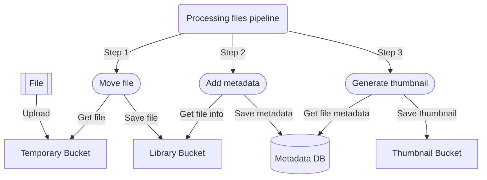

# Tag Files

Архитектура, функциональная спецификация, план миграции и согласованный целевой интерфейс для переписывания: [docs/rewrite](docs/rewrite/README.md). [Утверждённый UX-макет](docs/rewrite/prototype/README.md) зафиксирован 14 ноября 2026 по D-16.

Новая реализация находится в `app/` (Go/SQLite), `web/` (React), `tools/migrate/`
и `tools/backup/` (отдельные offline-инструменты). Локальный запуск двух новых
образов описан в [установке и обновлении](deploy/INSTALL.md), текущие результаты
и оставшиеся проверки — в [progress](docs/rewrite/progress.md).

```sh
scripts/check
scripts/check-app-image
```

Root Compose теперь запускает новую пару app/storage; `compose-dev.yml` собирает
её локально. Для установки с отдельными credentials и закреплёнными образами
используйте `scripts/install`. Реальные данные автоматически не подключаются и
не переносятся. Старые исходники и `compose-legacy.yml` / `compose-dev-legacy.yml`
сохранены для сверки и отдельного rollback до итоговой приёмки.

Разделы ниже описывают существующий C# + Angular прототип.

### Files processing



### Local starting project

You need to create buckets with names: `temporary`, `library`, `thumbnail` in S3
