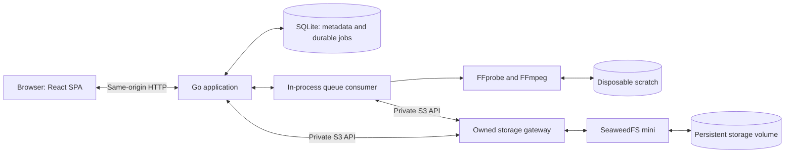
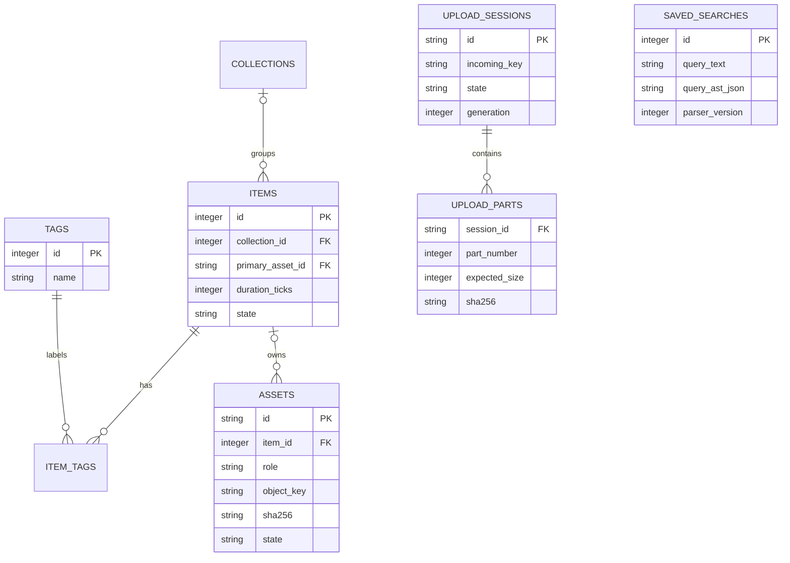
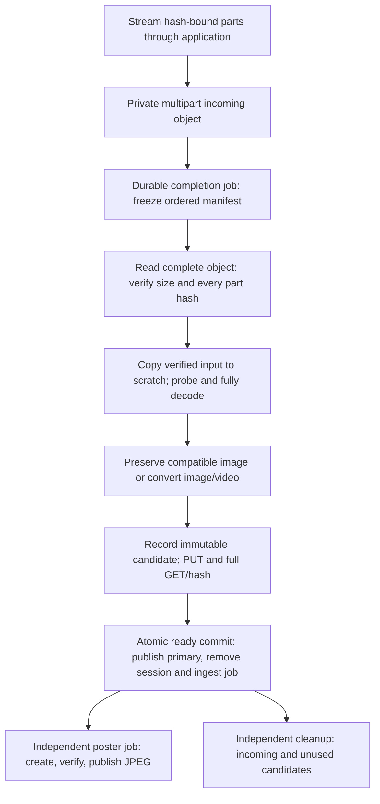

# Architecture

Tag Files is a local media library with a browser interface, one Go application,
and a private object store. SQLite holds metadata and durable work; object
storage holds media bytes. The application serves the SPA, JSON API, uploads,
and media from the same origin.

## Runtime

The Go application is a modular monolith built on `net/http`. Domain packages
own catalog, search, organization, ingestion, posters, and deletion rules.
HTTP handlers adapt those packages to the API; storage adapters handle SQLite
and S3. The application coordinates startup, request admission, background work,
recovery, and shutdown in one process.

The React and TypeScript SPA uses Vite, Mantine, React Router, and TanStack Query.
URLs carry library filters and viewer navigation; Query caches server data.
Browser workers calculate file and part hashes, while the upload coordinator
keeps resumable command receipts and limits concurrent transfers.

The application image includes the SPA and FFmpeg/FFprobe. The storage image
runs an owned gateway and SeaweedFS with LevelDB2 metadata. Compose exposes
only the application on loopback and keeps storage on an internal network.
Separate volumes hold application data, complete storage state, and scratch.

The gateway checks the private storage profile and library/volume identity.
Its boot epoch fences writes from a stopped storage instance. A durable proof
journal records actual multipart byte hashes for reconciliation. The Go S3
adapter uses AWS SDK v2; browsers receive application media URLs rather than
storage credentials or object-store URLs.

## Data model

Items have integer IDs, metadata, favorites, view counts, tags, and at most one
collection. Collections group items; removing a collection clears memberships
and retains the items. Tag names are Unicode, case sensitive, and may be
duplicated: IDs identify tags. Saved searches, shown as Categories in the UI,
store a versioned AST bound to tag IDs in JSON. Renaming a tag preserves those
bindings; explicitly editing query text binds its terms again.

The catalog represents `Unknown`, `Text`, `Image`, `Video`, and `Audio` kinds.
Duration is nullable and stored as integer 100 ns ticks. Assets use UUIDs and
describe immutable bytes: key, size, SHA-256, content type, and dimensions.
An item points to its authoritative primary asset. Posters are separate derived
assets. Candidates may exist before they belong to an item; a ready item must
own a verified primary.

`upload_sessions` and `upload_parts` hold unfinished uploads and immutable
part-size/hash bindings. `jobs` holds completion, ingestion, poster, cleanup,
and deletion work with leases and generation fencing. `object_write_intents`
records in-flight or uncertain external writes. Independent `cleanup_receipts`
and `deletion_assets` retain cleanup obligations after their initiating upload
or item is removed. These ownership links also use IDs and versioned payloads;
they are not all database foreign keys.

`operation_results` stores replayable mutation outcomes. `navigation_contexts`
stores ordered viewer snapshots, and `view_events` deduplicates view counts.
`library_meta` records schema, format, and storage pairing identities.

## Upload and media pipeline

The application currently supplies a 20 GiB file limit, 32 MiB parts, and two
parallel transfers. Uploads process image and video inputs through explicit
container, codec, pixel, output-size, and time limits. FFprobe inspects actual
bytes; filename extensions and browser MIME claims do not select the output.

Compatible JPEG, PNG, WebP, GIF, and AVIF images keep their bytes after full
decode validation. Other accepted image inputs, including supported HEIC,
BMP, and TIFF profiles, become PNG; orientation transforms are baked when
needed. Video becomes H.264 MP4 with AAC audio when present and faststart
metadata. Output is probed and fully decoded before its descriptor is accepted.
Unsupported profiles fail the upload with a retained error.

Primary publication makes the item available without waiting for its poster.
Posters are JPEGs within a 640-pixel square, without upscaling; transparent
regions use white. Poster failure leaves the primary available. Ready and
canceled uploads atomically lose their sessions while cleanup remains durable.
The Uploads view contains pending/error work, with no age-based session deletion.

## Consistency and resource boundaries

SQLite uses the `mattn/go-sqlite3` driver with WAL, `synchronous=FULL`, and foreign
keys. A process lock protects each library. One writer starts immediate
transactions; four read-only connections serve reads. Embedded Goose SQL owns
the schema, and sqlc generates static query code. S3 calls and media processes
run outside SQL transactions; short transactions commit their durable outcomes.

The single queue consumer uses leases, heartbeats, and generation checks to
reject stale results. Startup reconciles interrupted work before serving.
Scratch reserves source/output space for isolated attempts; capacity admission
checks physical bytes and inodes. Streams, object writes, process output,
FFmpeg threads, and subprocess lifetimes are bounded. Scratch is disposable;
durable incoming bytes remain in object storage until publication and cleanup.

`api/openapi.yaml` owns the HTTP contract and generated Go/TypeScript types.
Mutations use version checks and durable idempotency results where specified.
Binary handlers stream upload bodies and media separately from JSON binding.
`/media/{assetId}` resolves owned assets and supports GET, HEAD, byte ranges,
and conditional requests without exposing storage keys. Offline migration and
cold backup/restore tools live in `tools/`, outside the application API and UI.
