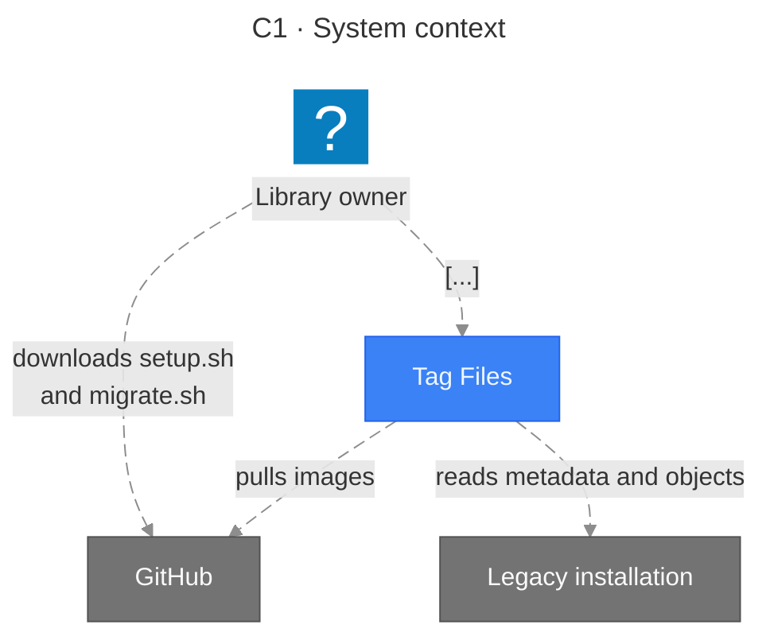
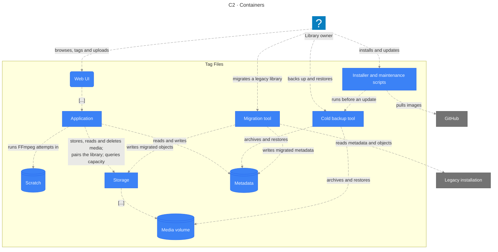
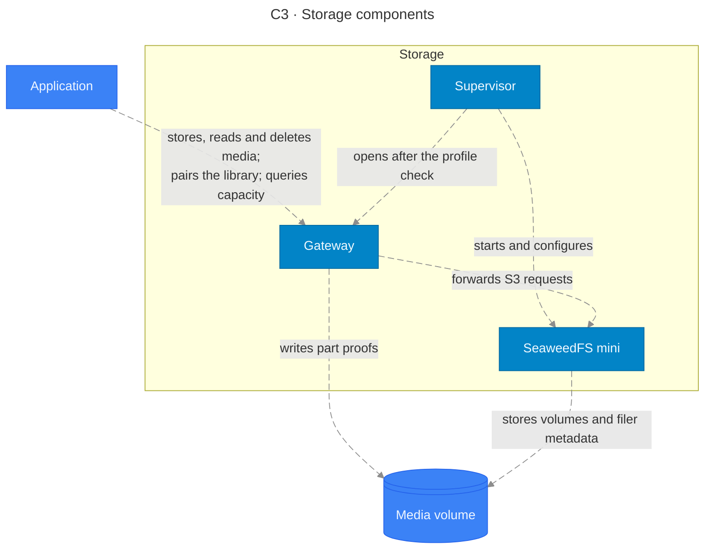
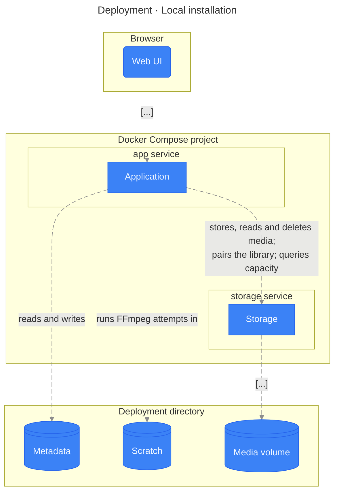

<!-- Generated by likec4 export markdown. Do not edit manually. -->

# Tag Files

Generated from the LikeC4 model (*.c4) in this folder by `likec4 export markdown`. Change the model and regenerate instead of editing the generated README.

### C1 · System context

### C2 · Containers

### C3 · Application components

```mermaid
---
title: "C3 · Application components"
---
graph TB
  TagFilesSpa@{ shape: rounded, label: "Web UI" }
  subgraph TagFilesApp["`Application`"]
    TagFilesApp.MediaServe@{ shape: rectangle, label: "Media delivery" }
    TagFilesApp.Lifecycle@{ shape: rectangle, label: "Lifecycle" }
    TagFilesApp.HttpApi@{ shape: rectangle, label: "HTTP API" }
    TagFilesApp.Worker@{ shape: rectangle, label: "Job worker" }
    TagFilesApp.Library@{ shape: rectangle, label: "Library domain" }
    TagFilesApp.Capacity@{ shape: rectangle, label: "Capacity admission" }
    TagFilesApp.Ingestion@{ shape: rectangle, label: "Upload ingestion" }
    TagFilesApp.Derived@{ shape: rectangle, label: "Posters, deletion and cleanup" }
    TagFilesApp.MediaProc@{ shape: rectangle, label: "Media processing" }
    TagFilesApp.Store@{ shape: rectangle, label: "Metadata store" }
    TagFilesApp.Objects@{ shape: rectangle, label: "Object storage adapter" }
  end
  TagFilesScratch@{ shape: disk, label: "Scratch" }
  TagFilesDb@{ shape: disk, label: "Metadata" }
  TagFilesStorage@{ shape: rectangle, label: "Storage" }
  TagFilesSpa -. "`calls the JSON API
and uploads parts`" .-> TagFilesApp.HttpApi
  TagFilesSpa -. "`loads media`" .-> TagFilesApp.MediaServe
  TagFilesApp.Lifecycle -. "`serves`" .-> TagFilesApp.HttpApi
  TagFilesApp.Lifecycle -. "`runs`" .-> TagFilesApp.Worker
  TagFilesApp.Lifecycle -. "`verifies storage pairing at startup`" .-> TagFilesApp.Objects
  TagFilesApp.HttpApi -. "`runs queries and commands`" .-> TagFilesApp.Library
  TagFilesApp.HttpApi -. "`creates sessions and stores parts`" .-> TagFilesApp.Ingestion
  TagFilesApp.HttpApi -. "`deletes items`" .-> TagFilesApp.Derived
  TagFilesApp.HttpApi -. "`admits work`" .-> TagFilesApp.Capacity
  TagFilesApp.MediaServe -. "`resolves assets`" .-> TagFilesApp.Store
  TagFilesApp.MediaServe -. "`streams objects`" .-> TagFilesApp.Objects
  TagFilesApp.Library -. "`reads and writes`" .-> TagFilesApp.Store
  TagFilesApp.Ingestion -. "`probes and normalizes uploads`" .-> TagFilesApp.MediaProc
  TagFilesApp.Ingestion -. "`records sessions, assets and jobs`" .-> TagFilesApp.Store
  TagFilesApp.Ingestion -. "`writes incoming and
candidate objects`" .-> TagFilesApp.Objects
  TagFilesApp.Worker -. "`runs completion and ingest jobs`" .-> TagFilesApp.Ingestion
  TagFilesApp.Derived -. "`renders posters`" .-> TagFilesApp.MediaProc
  TagFilesApp.Derived -. "`records receipts and inventories`" .-> TagFilesApp.Store
  TagFilesApp.Derived -. "`writes posters and deletes objects`" .-> TagFilesApp.Objects
  TagFilesApp.Worker -. "`runs poster, cleanup
and delete jobs`" .-> TagFilesApp.Derived
  TagFilesApp.Worker -. "`claims and fences jobs`" .-> TagFilesApp.Store
  TagFilesApp.Capacity -. "`checks scratch reservations`" .-> TagFilesApp.MediaProc
  TagFilesApp.Capacity -. "`checks storage capacity`" .-> TagFilesApp.Objects
  TagFilesApp.MediaProc -. "`runs FFmpeg attempts in`" .-> TagFilesScratch
  TagFilesApp.Store -. "`reads and writes`" .-> TagFilesDb
  TagFilesApp.Objects -. "`stores, reads and deletes media;
pairs the library; queries capacity`" .-> TagFilesStorage
  classDef primary fill:#3b82f6,stroke:#2563eb,color:#eff6ff
  class TagFilesSpa,TagFilesScratch,TagFilesDb,TagFilesStorage primary
  classDef sky fill:#0284c7,stroke:#0369a1,color:#f0f9ff
  class TagFilesApp.MediaServe,TagFilesApp.Lifecycle,TagFilesApp.HttpApi,TagFilesApp.Worker,TagFilesApp.Library,TagFilesApp.Capacity,TagFilesApp.Ingestion,TagFilesApp.Derived,TagFilesApp.MediaProc,TagFilesApp.Store,TagFilesApp.Objects sky
  linkStyle 0,1,2,3,4,5,6,7,8,9,10,11,12,13,14,15,16,17,18,19,20,21,22,23,24,25 stroke:#8D8D8D,stroke-dasharray:8 4
```

### C3 · Storage components

### Deployment · Local installation

