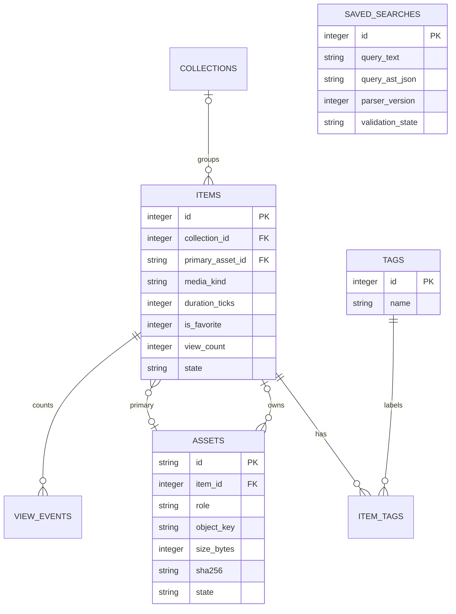
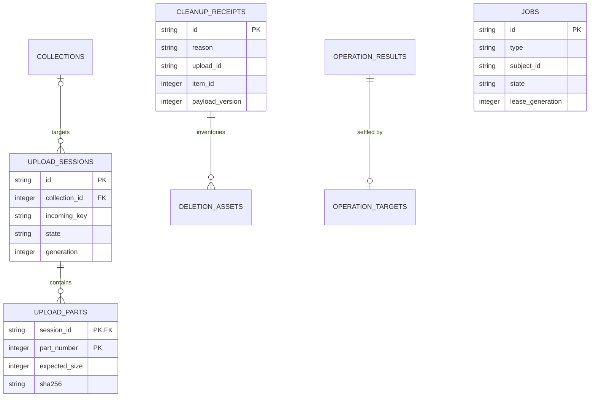

# Data model

SQLite schema from the Goose migrations in `app/internal/store/migrations/`
(schema version 7). Static queries live in `app/internal/store/queries/`.

## Catalog

## Uploads and durable work

`JOBS`, `CLEANUP_RECEIPTS`, `OBJECT_WRITE_INTENTS` and `OPERATION_TARGETS` refer
to uploads, items, assets and jobs by ID without foreign keys, so obligations
outlive the rows that created them. Saved searches bind to tags by ID inside
their AST JSON; navigation contexts hold ordered item IDs.

| Entity | Meaning |
|---|---|
| `items` | Catalog entry: integer ID (1..2^53−1), kind (`Unknown`, `Text`, `Image`, `Video`, `Audio`), nullable duration in 100 ns ticks, favorite flag, view count, at most one collection, state `importing`/`ready`/`deleting`/`missing`. A ready item must own a verified or published primary asset (enforced by triggers). |
| `tags` | Label identified by integer ID. Names are case sensitive (`COLLATE BINARY`), not normalized and may repeat. |
| `item_tags` | Item–tag membership; cascades from both sides. |
| `collections` | Named group of items. Deleting one clears item and pending-upload memberships and keeps the items. |
| `saved_searches` | Categories in the UI: name, query text, versioned AST bound to tag IDs, optional media kind, validation state `valid`/`unresolved`/`needs_review`. |
| `assets` | Immutable byte descriptor (UUID by code): role `primary` or `poster`, bucket/key, size, SHA-256, content type, dimensions, rotation, state `candidate`/`verified`/`published`/`missing`. Candidates have no item yet. Triggers protect bytes, descriptors and ready primaries. |
| `view_events` | Client event IDs that deduplicate view counts. |
| `upload_sessions` | Unfinished or failed upload: client file identity, expected size, part size/count, private incoming key and multipart upload, frozen completion manifest, state, generation. Ready and canceled uploads delete their session. |
| `upload_parts` | Immutable part size and SHA-256 binding per part number, then the confirmed ETag. |
| `jobs` | Durable leased work: `complete`, `ingest`, `poster`, `cleanup`, `delete`. Claims increment `lease_generation`; heartbeats and results must match it. |
| `cleanup_receipts` | Independent cleanup obligation (`cancel`, `ready`, `duplicate_mpu`, `poster_candidate`, `delete`) with a versioned payload; survives removal of its upload or item. |
| `deletion_assets` | Immutable inventory of the keys an item deletion must remove. |
| `object_write_intents` | In-flight or uncertain S3 writes (create/complete multipart, upload part, put object) recorded before the call; immutable. |
| `operation_results` | Replayable mutation replies keyed by `Idempotency-Key`, with request hash; kept 7 days. |
| `operation_targets` | Links a pending result to the upload completion or job that settles it; triggers complete or fail it. |
| `navigation_contexts` | Ordered viewer snapshot of up to 20,000 item IDs; expires after 24 h. |
| `library_meta` | Single row: library ID, schema and format versions, search generation counter, immutable storage pairing (storage and volume IDs). |

Tag names are 1–50 Unicode letters, decimal digits or hyphens from the Basic
Multilingual Plane. A search term binds to every tag with its name. Renaming a
tag keeps those bindings and re-renders stored query text; creating a tag binds
it to matching terms; editing query text binds its terms again. Searches in
`needs_review` are left unchanged.
