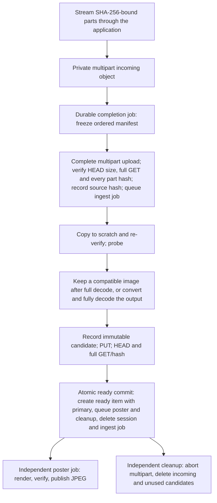

# Upload and media pipeline

The server fixes a 20 GiB file limit, 32 MiB parts and at most two parallel file
transfers, and sends them to the browser when uploads are created. A batch holds
1–500 files. The browser uploads at most two files at a time and sends each
file's parts in order; a Web Worker hashes files and parts. FFprobe inspects the
actual bytes, never the browser's MIME type, to choose the processing path. Only
images and video can be uploaded; `Unknown`, `Text` and `Audio` items come only
from the legacy migration.

## Normalization

- JPEG, PNG (including APNG), WebP, GIF and AVIF keep their bytes after a full
  decode; animated GIF and APNG keep every frame. JPEGs with a non-normal EXIF
  orientation are converted instead.
- Other accepted images (HEIC, BMP, TIFF) and oriented JPEGs become PNG with
  orientation applied. Conversion keeps the first frame only. HEIC with ICC
  profiles, HDR (PQ/HLG), non-square pixels, crop/scale properties or auxiliary
  images is rejected.
- Every video is re-encoded to H.264 MP4 (libx264 veryfast, CRF 23, yuv420p) at
  the source resolution with rotation applied, faststart metadata and no other
  metadata. One video stream and the default or first audio stream (AAC 128 kb/s)
  are kept. Odd dimensions and HDR (PQ/HLG) are rejected; an output more than
  0.5 s shorter than the source fails.
- Conversion decodes strictly (any decode error fails it); outputs are probed and
  fully decoded before their descriptor is accepted.

## Limits

| Limit | Value |
|---|---|
| Containers | JPEG, PNG/APNG, WebP, GIF, BMP, TIFF, MP4/MOV/HEIF/AVIF, Matroska/WebM, AVI, MPEG-TS |
| Image codecs | MJPEG, PNG, APNG, WebP, GIF, BMP, TIFF |
| Video codecs | H.264, HEVC, MPEG-4, MPEG-2, VP8, VP9, AV1 |
| Audio codecs | AAC, MP3, Opus, Vorbis, AC-3, E-AC-3, FLAC, ALAC, PCM |
| Pixels | 64 megapixels per frame, each side ≤ 32768 |
| FFmpeg | ≤ 256 streams, 8 MiB probe size, 5 s analysis, 256 MiB allocation, 2 threads |
| Output | Primary ≤ 20 GiB (`TAG_FILES_MAX_OUTPUT_BYTES`); poster ≤ 8 MiB |
| Time | Probe 30 s, conversion 6 h, poster 5 min |
| Scratch | 64 GiB reservation limit by default (`TAG_FILES_SCRATCH_MAX_BYTES`) |

## Errors and retries

`unsupported_media_type`, `unsupported_codec`, `invalid_media`,
`media_limit_exceeded` and `object_integrity` fail the upload permanently.
Temporary errors are retried up to three times after 5 s, 30 s and 120 s. The
session then becomes `failed` with its error code and stays until the user
retries or cancels it; nothing expires sessions.

## Posters

An independent job renders the poster from the published primary: the first
image frame, or the video frame at 10% of its duration (the first frame when the
duration is unknown), with display rotation applied. Posters are JPEGs within a
640-pixel square, never upscaled, with transparency on white; they are probed
and decoded before publication. Poster failure leaves the primary available.

## Sessions and cleanup

Ready publication and cancel delete the session atomically and queue cleanup;
cleanup receipts retry until the incoming object, its multipart upload and
unused candidates are gone. The Uploads view lists every remaining session,
which means pending and failed work only.
