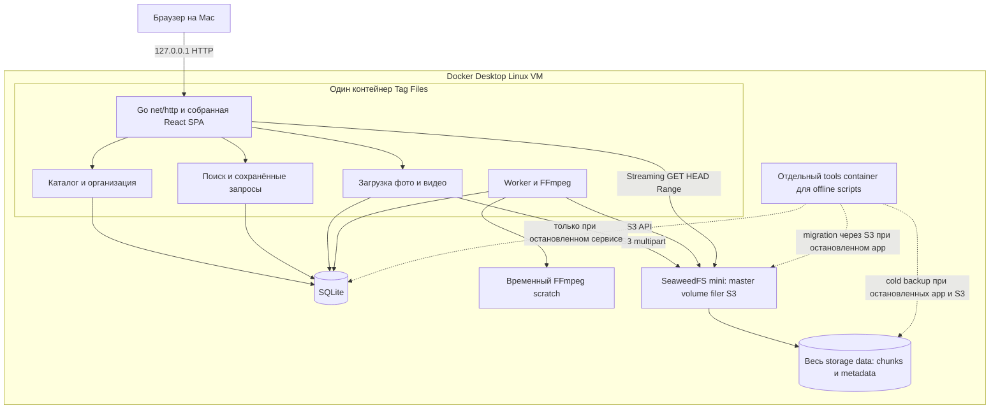
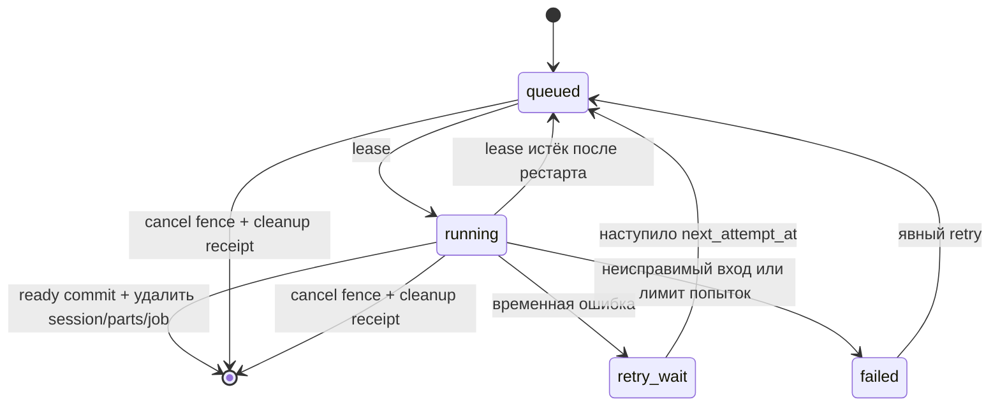

# Целевая архитектура Tag Files

Статус на 14 ноября 2026 года: архитектура первого production-релиза на выбранном для планирования стеке Go + React/Mantine, SQLite, durable jobs и SeaweedFS. Прикладной стек остаётся технической рекомендацией исследования; одобрение интерфейса не является отдельным подтверждением языка или библиотек владельцем. Архитектура реализует F-01…F-38 с принятыми изменениями D-01…D-16 из [реестра решений](06-product-questions.md). По D-16 весь текущий интерфейс и поведение одобренного макета v27 зафиксированы как цель реализации; [baseline](prototype/accepted-baseline.json) связывает одобрение с HTML и исходниками. SHA-256 HTML: `b0d2f5ea4a7a9bd3a06ddeb0968dd749b3655663dcc0ca2e2819525c6dcb50ea`. Исторические наблюдения legacy и прежние варианты не переопределяют эту цель. Технические feature gates проверяют способ реализации, а не возобновляют выбор интерфейса.

Подтверждённый сценарий — один пользователь открывает приложение в браузере на том же современном Mac, где работает Docker Desktop. Библиотека содержит несколько тысяч элементов и около 100 GB медиа. Архитектура рассчитана на локальное приложение с долговечными данными и последующее развитие функций.

## Выбор подхода

| Подход | Что даёт | Цена и ограничения | Решение |
| --- | --- | --- | --- |
| Go и React, модульный монолит, SQLite, отдельный локальный S3 | Небольшой язык и стандартный HTTP, явные SQL/транзакции, общий генерируемый контракт для сервера и клиента | Нужны закреплённые генераторы, migration runner и SQLite driver; согласованность SQLite/S3 реализует приложение | Выбранный профиль для переписывания и сопровождения AI-агентами |
| .NET 10 LTS и React с теми же SQLite/S3 | Цельный ASP.NET Core и долгий цикл поддержки, встроенный lifecycle фоновых служб | Требуется единообразно применять соглашения платформы; тот же durable pipeline и S3-протокол всё равно проектируются явно | Почти равноценная альтернатива в сохранённом сравнении; текущий выбор Go не меняет |
| Node.js 26 LTS, Fastify и React с теми же SQLite/S3 | Один TypeScript на сервере и клиенте, JSON Schema tooling | Нужны runtime validation и явный lifecycle subprocess; CPU-bound работу нельзя блокировать в event loop | Третья альтернатива, без доказанного выигрыша для этой библиотеки |
| .NET 10 LTS и Angular 22 с теми же SQLite/S3 | Цельные HTTP, формы, маршрутизация и UI-компоненты | Нужны единые соглашения Angular DI/шаблонов; архитектурной необходимости сохранять языки прототипа нет | Исторический вариант, уступивший выбранному профилю по критериям исследования |
| Go и React с обычными файлами | Один контейнер, прямой доступ к файловой системе | Приложение реализует durable публикацию, multipart/resume и физическую организацию файлов | Хранилище уже выбрано отдельно; S3 ADR не пересматривается |
| PostgreSQL и отдельный worker | Независимое масштабирование метаданных и обработки | Дополнительные сервисы и эксплуатация ради локальной библиотеки | Пересмотреть при изменении позиционирования |

«Переписать с нуля» здесь означает заново реализовать контракты и границы ответственности. Объектное хранилище выбирается независимо от прикладной БД и топологии worker. Выбран **SeaweedFS 4.53, `weed mini`, embedded LevelDB2, сохранённое глобальное fsync rule**. Сравнение вариантов, проверенные источники и условия выбора находятся в [решении по S3](08-s3-storage-decision.md). MinIO остаётся только источником старых объектов на время миграции.

Оценка стека учитывает, что код будут писать и сопровождать AI-агенты: нужны явные контракты, единый стиль, ограниченный набор зависимостей и быстрые воспроизводимые проверки. Она не опирается на знакомство человека с C# или Go и не доказывает, что агенты лучше владеют одним языком. Меньший расход RAM, более быстрый FFmpeg или более надёжная запись от выбора Go не обещаются; суммарные ресурсы app + SeaweedFS + FFmpeg измеряются на Mac. Цена выбора и почти равноценная альтернатива .NET 10 + React разобраны в [ADR по стеку](09-application-stack-decision.md).

## Стек и политика версий

| Область | Выбор | Обоснование |
| --- | --- | --- |
| Сервер | Go 1.27.4, `net/http`, `http.ServeMux`, `log/slog` | Стандартные HTTP/lifecycle primitives и структурированные логи; отдельный router/framework не нужен |
| Метаданные | SQLite, `database/sql`, `mattn/go-sqlite3` | Явные транзакции и SQL; CGO/C compiler в builder, совместимый Linux runtime |
| SQL и схема | `sqlc` для статических запросов, параметризованный compiler AST → SQL для поиска; embedded SQL migrations через `goose` | Типы запросов генерируются; история схемы reviewable, legacy import в неё не входит |
| Клиент | React 19.3.1, TypeScript `strict`, React Router 8 Data Mode, TanStack Query 5, Mantine core/hooks/form, CSS Modules | Зафиксированный набор маршрутов, server cache и UI без SSR; URL и черновики имеют явных владельцев |
| Сборка клиента | Vite 8.3, Node.js 26 LTS, npm с lockfile | Node нужен только на стадии сборки; в runtime работает собранная SPA |
| Медиа | FFmpeg и ffprobe, программная обработка | Один инструментарий для метаданных, poster и воспроизводимого видео |
| Объекты | SeaweedFS 4.53 `weed mini`, embedded LevelDB2, глобальный `fsync=true`, отдельный Docker named volume | Клиент — AWS SDK for Go V2 с path-style endpoint; прямые MPU API и проверенный streaming/checksum профиль |
| Очередь | Таблица jobs в той же SQLite, один worker внутри процесса | Команда и задание фиксируются одной транзакцией; goroutines/channels обслуживают исполнение и пробуждение |
| HTTP контракт | REST JSON `/api/v1`, OpenAPI 3.0.3 spec-first; `oapi-codegen` для JSON, `openapi-typescript`/`openapi-fetch` для TS | Один исходный контракт; raw streaming handlers для binary operations описаны в той же спецификации |
| Проверка | `gofmt`, `go vet`, `go test`, race/integration checks, настоящая SQLite, Playwright, реальные маленькие FFmpeg fixtures | Проверяет сгенерированные контракты, SQL, media pipeline и пользовательские сценарии |
| Поставка | Compose: закреплённые app/S3 образы, linux/arm64 и linux/amd64; CGO builder и совместимый Debian runtime с FFmpeg | Apple Silicon — основная проверяемая платформа; SPA и FFmpeg входят в образ приложения |
| Перенос и резервирование | Отдельные offline-скрипты вне кода и runtime-образа сервиса | Миграция одноразовая; backup/restore организует пользователь по инструкции |

На 11 ноября 2026 года актуальны поддерживаемые Go 1.27.4 и 1.26.11, оба patch выпущены 10 ноября. Go 1.27.0 вышел 19 августа 2026. Официальная политика поддерживает ветку до появления двух более новых major-версий; отдельной LTS-ветки нет. Выбран Go 1.27.4 с регулярными проверенными обновлениями toolchain. У альтернативы .NET 10 LTS поддержка до 14 ноября 2028 года; .NET 9 из прототипа завершил поддержку 10 ноября 2026. Более длинный цикл .NET — реальный аргумент в пользу альтернативы, а не преимущество Go. [Go release policy/history](https://go.dev/doc/devel/release), [Microsoft support policy](https://dotnet.microsoft.com/en-us/platform/support/policy/dotnet-core).

Версии React/Vite/Node и frontend-библиотек проверяются как совместимый набор; политика поддержки React оценивается отдельно от циклов Angular и Node. Точные patches генераторов, SQLite/S3 modules, React Router, TanStack Query, Mantine и TypeScript фиксируются в lockfiles и builder images после integration gate, затем обновляются проверяемыми релизами. Базовые версии и первичные источники — в [ADR по стеку](09-application-stack-decision.md). `mattn/go-sqlite3` собирает bundled SQLite по умолчанию; системная `libsqlite3` включается отдельным build tag и не подмешивается случайно. `modernc.org/sqlite` остаётся альтернативой без CGO для обычной сборки, с собственной ценой зависимостей/транспиляции; static binary не является целью, поскольку app-образ содержит FFmpeg. [mattn driver](https://github.com/mattn/go-sqlite3), [modernc driver](https://pkg.go.dev/modernc.org/sqlite).

## Состав приложения



Прикладные модули разделяются кодом и контрактами. Один процесс Tag Files владеет SQLite и jobs; второй экземпляр с той же БД должен завершаться с понятной ошибкой. Объектным volume владеет только S3-контейнер. Внешний migration script использует S3 API при остановленном приложении; cold backup/restore получают оба volume при остановленных приложении и gateway. Эти инструменты не являются модулями приложения. Отдельный worker-сервис сейчас не нужен.

Рекомендуемые границы:

- `Catalog`: элементы, описание, избранное, просмотры, жизненный цикл удаления.
- `Organization`: теги, коллекции, сохранённые запросы, статистика тегов.
- `Search`: parser → AST → параметризованная выборка, сортировки, контекст навигации.
- `Ingestion`: сессии загрузки, проверка содержимого, публикация primary asset.
- `Media`: probe, преобразование в рабочий формат с сохранением разрешения, poster, выдача контента.
- `Operations`: задания, startup recovery и сверка текущего хранилища.

Вне сервиса находятся одноразовый legacy migration script и независимый backup/restore script с инструкцией. Они работают с документированным форматом библиотеки и manifest, а не с экспортным HTTP API или maintenance CLI приложения. Автоматические миграции собственной SQLite-схемы между новыми версиями остаются обычной обязанностью приложения; они не импортируют legacy данные.

Бизнес-правила располагаются в прикладных сервисах; HTTP handlers переводят запросы и ошибки. SQLite driver, connection pools и миграции сосредоточены в одном store package, границы транзакций видны в прикладных операциях. Статические SQL-запросы генерирует `sqlc`, динамический фильтр строит ограниченный compiler AST; ORM, универсальные repository, DI framework, mediator, event bus и отдельный CQRS framework не добавляются. Job executor знает конкретные виды работ и не превращается в универсальную платформу автоматизаций.

Для работы AI-агентов модули имеют явные входы/результаты и зависимости через constructors; domain/parser не импортируют HTTP, S3 SDK или SQLite driver. Общие исходники контрактов — OpenAPI и SQL migrations; сгенерированные Go/TS types и `sqlc` queries не редактируются вручную. `oapi-codegen` strict JSON server даёт типизированные request/response interfaces, но не заменяет runtime validation полей и прикладных правил. Генерация и её настройки закреплены, CI повторяет её и требует отсутствие diff. Прямые binary handlers соблюдают ту же спецификацию и проверяются отдельно, без binder/validator, который заранее читает stream целиком. [sqlc SQLite](https://docs.sqlc.dev/en/stable/tutorials/getting-started-sqlite.html), [goose](https://github.com/pressly/goose), [oapi-codegen](https://github.com/oapi-codegen/oapi-codegen).

## Концептуальные проблемы прототипа

| Проблема | Почему важна при переписывании | Решение и проверка |
| --- | --- | --- |
| Загрузка зависит от S3 notification и очереди в памяти | Перезапуск способен разорвать связь между сохранённым намерением и выполнением | Задания в SQLite, lease, startup reconciliation; тест остановки на каждом этапе |
| Объект, строка БД и preview имеют разные моменты публикации | Нет общей транзакции между S3/FS и SQLite | Явный протокол публикации и повторяемая сверка |
| Вход удаляется до полного завершения публикации результата | При сбое можно потерять и input, и доступную рабочую копию | Input очищается только после подтверждённого S3 PUT, полного GET/hash и durable SQLite commit; глобальный fsync rule обязателен |
| Имя тега одновременно является пользовательской подписью и частью сохранённого запроса | Переименование меняет результаты, удаление скрывает зависимость | Ссылки на ID в AST; исходный текст и версия parser сохраняются |
| Коллекция и категория выглядят близкими способами организации | Ручное членство смешивается с динамической выборкой | Одна nullable Collection у item; Categories применяют saved queries, как в одобренном UI, без постоянного поясняющего текста |
| Запрос, порядок выдачи и навигация живут только в памяти клиента | Refresh и Back не воспроизводят рабочий контекст; Random не задаёт стабильной последовательности | URL state, seed и явный ограниченный контекст навигации |
| Статус active list сам по себе не доказывает публикацию | Исчезнувшая запись могла означать сбой | D-15: pending/error queue; ready подтверждается item с upload ID, ошибка остаётся до retry/cancel, отдельной истории нет |
| Несколько портов и жёсткие localhost endpoints | Установка и смена порта затрагивают сервер, SPA и медиа | Один origin и относительные URL |
| Docker запускает dev server клиента, службы не составляют проверенный релиз | Замена образов не гарантирует совместимости и готовности | Собранная SPA внутри app-образа, закреплённая пара app/S3, health/readiness и immutable release |
| Нет документированного согласованного набора метаданных и файлов | Внешний backup SQLite без медиа либо медиа без metadata не восстанавливает продукт | Версионированный формат библиотеки и отдельные offline scripts с manifest/verify/restore; сервис не управляет бэкапами |

Основания: [Program.cs](../../tag-files-service/TagFilesService.WebHost/Program.cs), [FilesProcessingQueue](../../tag-files-service/TagFilesService.FilesProcessing/FilesProcessingQueue.cs), [pipeline](../../tag-files-service/TagFilesService.FilesProcessing/FilesProcessingService.cs), [parser](../../tag-files-service/TagFilesService.Library/TagQueryConverter.cs), [SearchService](../../tag-files-web-app/src/app/services/search.service.ts), [NavigationContextService](../../tag-files-web-app/src/app/services/navigation-context.service.ts), [Dockerfile клиента](../../tag-files-web-app/Dockerfile). Это ограничения модели и эксплуатации, а не перечень дефектов для исправления в прототипе.

## Целевая модель данных

Ниже рекомендуемая схема v1; названия таблиц — контракт архитектуры, окончательный DDL создаётся миграцией реализации. Все ID элементов, тегов, коллекций и категорий — положительный SQLite INTEGER и Go `int64`, в API JSON number в диапазоне безопасного JavaScript integer; выход за него отклоняется до сериализации. Старые ID сохраняются. Внутренние asset/job/upload ID — случайные UUID, не пользовательские имена.

| Таблица | Существенные поля и ограничения |
| --- | --- |
| `items` | `id`, `upload_id?` UNIQUE, `description`, `media_kind`, `uploaded_at_utc`, `collection_id?`, `is_favorite`, `view_count>=0`, `last_view_at_utc?`, `duration_ticks?`, `primary_asset_id?`, `state`, `version` |
| `tags` | `id`, `name`, `version`; index по `name COLLATE BINARY`; существующие совпадающие имена мигрируются без слияния |
| `item_tags` | PK `(item_id,tag_id)`, FK на обе таблицы, index `(tag_id,item_id)` |
| `collections` | `id`, `name`, `version`; обложка вычисляется по текущему правилу, ручного выбора в baseline нет |
| `saved_searches` | `id`, `name`, `query_text`, `legacy_source_text?`, `query_ast_json`, `parser_version`, `media_kind?`, `validation_state`, `version` |
| `assets` | `id`, `item_id`, `role`, `bucket`, `object_key`, UNIQUE `(bucket,object_key)`, `size_bytes`, `sha256`, `content_type`, `width?`, `height?`, `rotation?`, `provenance`, `profile_version?`, `state` |
| `upload_sessions` | `id`, `batch_id`, `client_filename`, `expected_size`, `part_size`, `incoming_key`, `multipart_upload_id?`, `completion_manifest?`, `source_sha256?`, `collection_id?`, `state`, `generation`, `version`; только незавершённые и failed, без expires_at/TTL |
| `upload_parts` | PK `(session_id,part_number)`, `expected_size`, `sha256`, `etag?`, `state`; binding размера/содержимого фиксируется до передачи в S3, повтор номера допускает только те же байты |
| `jobs` | `id`, `type`, `subject_id`, `dedupe_key` UNIQUE, `state`, `attempt`, `next_attempt_at`, `lease_until?`, `lease_generation`, `progress_json`, `error_code?`, `created_at`; только необходимые работы, без архива succeeded/cancelled |
| `cleanup_receipts` | `id`, `reason`, upload/item ID, owned keys и MPU IDs, generations/in-flight intents, state; самостоятельные payload для cleanup после удаления session, без обязательного FK на неё; живут до завершения abort/delete/reconcile, без TTL и истории |
| `view_events` | `(item_id,event_id)` UNIQUE, `recorded_at`; ограниченная история для идемпотентности |
| `operation_results` | `operation_id` UNIQUE, request hash, result/status, expiry; защита повторяемых команд |
| `library_meta` | library UUID, `schema_version`, `format_version`, generation счётчик изменений поиска |

Legacy mapping и журналы переноса принадлежат отдельному скрипту и сохраняются в его рабочем каталоге рядом с manifest. Для их обработки в runtime-сервисе нет таблиц, handlers или зависимостей от MinIO.

По D-12 у `items` нет пользовательского title/display name/original filename. Предыдущее `display_name` было лишним допущением, а заголовки в первом UX-макете — вымышленными данными. `upload_sessions.client_filename` нужен только незавершённой/ошибочной загрузке, удаляется вместе с session при ready/cancel и не переносится в готовую медиатеку. Внешний архив миграции сохраняет исходные processing rows без потерь. Внутренние asset ID, object keys, MIME, размеры, hashes и прочие operational metadata остаются частью backend: отсутствие их в UI не отменяет проверки, storage-контракт или диагностику. Legacy `description` сохраняется в схеме/API, но viewer и editor не показывают его.

По D-15 очередь не имеет таблиц upload_history/upload_batches с архивом исходов: batch — проекция текущих upload_sessions по batch_id; пустой batch исчезает. `items.upload_id` — UUID приложения для нового импорта (не multipart_upload_id S3), nullable UNIQUE; внешний legacy importer ставит NULL. Это стабильная origin identity/lookup результата, не FK на upload_sessions: session удаляется после ready. Исходного имени или истории загрузки в item нет. При ready одна SQLite-транзакция проверяет fence/generation, публикует item с этим upload ID, удаляет upload_session/parts/завершённый ingestion job и сохраняет самостоятельные cleanup receipts/jobs и poster work. После неё GET session/повтор Complete сначала могут найти ready item по upload_id и вернуть success/itemId. Если нет ни session, ни item, возвращается неизвестный upload; Complete не создаёт новую session и не воскрешает отменённый/удалённый item. Рабочие receipts удаляются только после фактически завершённой очистки/reconcile.

`items.state`: `importing`, `ready`, `deleting`, `missing`. Наличие проверенного primary asset обязательно для `ready`; нет primary — запись не выдаётся как успешно загруженная. Отсутствие preview не скрывает ready item. `media_kind` сохраняет все текущие enum: `Unknown`, `Text`, `Image`, `Video`, `Audio`. Новые uploads принимают только распознанные фото и видео; иные типы дают `unsupported_media_type`. Исторические Unknown/Text/Audio сохраняются отдельным importer, остаются в API-фильтрах и доступны для скачивания. Новый viewer для них не предполагается; активное HTML/SVG не исполняется в origin приложения.

Коллекции — плоский аналог папок: у item не более одной коллекции, несколько классификаций задаются тегами. `collection_id ON DELETE SET NULL`; удаление коллекции сохраняет её элементы. Публичного удаления тегов в baseline нет, как в прототипе; возможное добавление требует dependency policy для категорий. Primary asset принадлежит одному item; физическая дедупликация в v1 отсутствует, одинаковые SHA-256 не означают общее владение файлами.

Числа времени хранятся с явными единицами: timestamp как UTC ISO 8601 с `Z` и одинаковой точностью; `duration_ticks` как nullable SQLite INTEGER / Go `int64` в legacy .NET ticks по 100 ns. Внешний importer переносит это целое без промежуточных float seconds; сортировка работает по INTEGER. Go `time.Duration` измеряет наносекунды, поэтому прямой cast меняет единицу, а умножение ticks на 100 может переполнить `int64`; этот тип не используется для хранения legacy duration. В API остаётся только `durationSeconds` с дробной частью и документированным округлением; внутреннее поле ticks не добавляется в публичный контракт. Исходные legacy timestamps сохраняются отдельно в migration manifest, если требуют интерпретации.

`version` — прикладной увеличиваемый INTEGER. Изменения форм требуют `If-Match`; stale editor получает 412 и предложение перезагрузить состояние. Даже один пользователь может редактировать в нескольких вкладках.

Рекомендуемые индексы: `(state,uploaded_at_utc,id)`, `(state,duration_ticks,id)`, `(state,view_count,id)`, `(collection_id,state,uploaded_at_utc,id)`, `(state,is_favorite,id)`, `item_tags(tag_id,item_id)`, `jobs(state,next_attempt_at,created_at)`. Проверить query plans на репрезентативной библиотеке; FTS и поисковый сервис для boolean-поиска по тегам не нужны.

## Объектная библиотека и локальные данные

```text
app-data volume:
  /data/library.sqlite             # также WAL/SHM при наличии
scratch volume:
  /scratch/<job-uuid>/source.cache  # восстанавливается из incoming
  /scratch/<job-uuid>/output.part
S3 bucket tag-files:
  incoming/<library-id>/<upload-id>/source
  primary/<library-id>/<asset-id>/media.<safe-extension>
  previews/<library-id>/<asset-id>/<profile-version>/poster.jpg
storage-data volume:
  /data/                          # весь Seaweed root: master, filerldb2, volumes, config
```

Приложение вычисляет логический object key; физическое размещение в chunks и volumes выполняет SeaweedFS. Префиксы отражают назначение объектов, дополнительного распределения `ab/cd` по UUID приложение не делает. Входное имя клиента отображается только у текущей незавершённой/ошибочной загрузки и не становится именем готового item. Теги/коллекции не входят в ключи, переименование не перемещает медиа. Finder-доступ не требуется. Сотни GB определяют требования к свободному месту и I/O; число объектов и операции листинга проверяются отдельно. Manifest внешних инструментов находится вне рабочих volume.

Ключи ASCII, без `..`, пустых сегментов, завершающего `/` и конфликта «объект одновременно родительский каталог». Опубликованные primary/preview неизменяемы: новая версия получает новый asset ID. SQLite хранит идентичность, SHA-256 всего файла и владение объектом; metadata S3 — вспомогательные поля, не замена каталога. Бизнес-теги не хранятся как S3 object tags. `ETag` — непрозрачный токен S3, особенно при multipart; он не является общим SHA-256.

Для новых загрузок сохраняется одна готовая рабочая версия и poster; отдельного архива входных оригиналов и дополнительной playback-копии нет. Видео, как сейчас, проходит в MP4 H.264/AAC с faststart и становится primary. Фото следует текущему подходу: подходящий для показа формат можно сохранить без изменения байтов; если преобразование необходимо, его результат становится primary. Во всех случаях основной файл сохраняет исходное разрешение, пропорции и ориентацию; уменьшение выполняется только для preview. Конвертация в другой формат сама по себе не улучшает качество исходника.

Input находится в multipart/incoming только на время передачи, обработки и retry. Durable input — объект S3, локальный scratch не является единственной копией. Он удаляется после проверки результата и фиксации primary+metadata; постоянного архива input нет. Poster строится из primary и версионируется; его ошибка не уничтожает основную копию. Legacy файлы переносятся отдельным скриптом без массового перекодирования; старый MP4 получает `provenance=legacy_transcoded`, а новый результат конвертации — `converted_upload`. Повторное построение poster возможно из primary, восстановление более качественного оригинала не является функцией продукта.

## Согласованность загрузки и обработки

1. Сохранить session UUID, expected size, part size, incoming key и collection snapshot в SQLite, затем инициировать S3 multipart и зафиксировать его upload ID. Потерянный ответ Create восстанавливается через ListMultipartUploads для точного session key; лишние принадлежащие session MPU abort после сверки. S3 notification не создаёт jobs.
2. Браузер вычисляет SHA-256 каждой части и передаёт её через same-origin app API с размером/checksum. До forwarding приложение фиксирует binding `(session,partNumber,size,SHA256)` в SQLite, затем потоково вызывает UploadPart с проверяемой S3 checksum без полного буфера файла и локальной копии. Часть не больше 5 GiB, лимит 10 000 частей, минимум 5 MiB кроме последней. Повтор номера допускает только те же size/SHA256; другое содержимое получает 409 и требует новой session. GET session сверяет ListParts с bindings. SQL-транзакция не держится на время передачи.
3. Complete атомарно закрывает приём новых частей, ожидает завершения известных in-flight writers и фиксирует ordered manifest partNumber/ETag и `completing` до CompleteMultipartUpload. Lease/generation не останавливает запрос, уже исполняемый S3; поздний UploadPart безопасен только благодаря неизменяемому part binding и проверке checksum сервером. InvalidPart не разрешает слепо заменить manifest любым ListParts. После каждого Complete, включая 200, проверяются incoming HEAD и полный GET с размером/SHA-256; ошибочный либо неоднозначный исход остаётся у прежней session. Проверяется соответствие сохранённым part bindings; составной S3 checksum не выдаётся за SHA всего файла. Одна транзакция фиксирует source hash, меняет session в `queued` и создаёт job с dedupe key. Повтор complete возвращает прежний результат. Для пользователя это одна автоматическая загрузка без подтверждения конвертации.
4. Worker получает lease в короткой транзакции; потоково читает incoming в scratch, вычисляет source SHA-256, выполняет probe/FFmpeg вне SQL-транзакции. Новые не-фото/не-видео отклоняются до публикации. Input остаётся в S3. Проверяются exit code, размер, декодируемость, тип, исходное разрешение/ориентация и SHA-256 результата; при passthrough — те же свойства копии.
5. До публикации попытке выделяется durable candidate asset ID/key с ожидаемыми size/SHA256, job и lease generation. PUT результата в уникальный ключ → успешный ответ S3 с глобальным fsync rule → полный GET и сравнение SHA-256/размера → durable SQLite ready commit primary asset/item с UNIQUE upload_id, удалением session/parts/завершённого ingestion job, записью самостоятельного cleanup и poster job с проверкой generation. После потерянного PUT-ответа GET/hash того же candidate разрешает неоднозначность; повтор PUT допускает только прежние байты. Другая conversion или lease получает новый candidate, stale worker не может заменить актуальные байты или commit. Неиспользованные известные candidates очищаются повторяемым job.
6. После проверенного primary и SQLite ready commit запись сразу исчезает из Uploads. Независимый durable cleanup удаляет incoming и scratch, не удерживая строку; падение после commit восстанавливает cleanup по его собственному payload, а готовый item — по upload_id. Poster публикуется тем же PUT/GET/hash/SQL порядком отдельной работой, его ошибка не уничтожает primary и не возвращает upload в очередь. Провал до ready оставляет failed session и необходимый input без TTL до успешного retry или ручного cancel.
7. Reconciler сверяет sessions/jobs, привязанные MPU, известные incoming/candidate/primary и намерения удаления. Отмена навсегда запрещает app commit; receipt повторяет Abort и HEAD/Delete incoming, если запоздавший Complete всё же создал объект. Владение и состояние in-flight работ проверяются до Abort/Delete; возраст не является основанием удаления. Неизвестные ключи отражаются в report без автоматического удаления. Deletion receipts не дают восстановить удалённый item из случайно оставшегося объекта.

Go SDK использует прямые MPU operations, а не `manager.Uploader`, который для обычного `io.Reader` буферизует части. Для browser body выбирается проверенный nonseekable профиль: явный `ContentLength`, при необходимости `SwapComputePayloadSHA256ForUnsignedPayloadMiddleware` для SigV4 и явный `ChecksumSHA256` части. `UNSIGNED-PAYLOAD` относится к подписи; gateway всё равно обязан проверить SHA-256 реального тела и отвергнуть неверный digest. Чтение body ограничено ожидаемым размером, число streams ограничено глобально. SDK не повторяет отправку уже прочитанного nonseekable body: повтор тех же bytes/digest выполняет браузер, потерянный ответ разрешается через durable binding и ListParts. Для PUT локального output допустим seekable file и отдельная проверенная retry policy. API shape `Body io.Reader` не доказывает streaming без seek/buffering; точный набор SDK modules и defaults проходит conformance с SeaweedFS 4.53. [AWS nonseekable input и buffers](https://docs.aws.amazon.com/sdk-for-go/v2/developer-guide/sdk-utilities-s3.html), [AWS checksum defaults и MPU](https://docs.aws.amazon.com/sdk-for-go/v2/developer-guide/s3-checksums.html).

Атомарного commit между S3 и SQLite нет: S3 убирает собственную реализацию объектного хранения, но не прикладной протокол. SHA-256 в user metadata и multipart composite checksum не заменяют полного GET/hash. В SeaweedFS обязательное глобальное правило синхронизирует PUT данных/index и filer metadata; параметры batching сами его не включают. У DELETE отдельный контракт, поэтому receipts сверяются после restart. Проверка внезапного выключения Docker VM входит в приёмку; анализ кода не доказывает прохождение flush до физического накопителя Mac. Подробности и источники — в [S3 ADR](08-s3-storage-decision.md).

### Состояния job и повтор



Claim — `BEGIN IMMEDIATE`, select доступного job и update с проверкой прежнего состояния/lease, commit. Writer handle использует `SetMaxOpenConns(1)` и проверенный driver DSN `_txlock=immediate`, чтобы `BeginTx` действительно начинал нужную транзакцию; произвольный `TxOptions.Isolation` этого не гарантирует. Альтернатива — выделенный `*sql.Conn` с явными BEGIN/COMMIT/ROLLBACK на нём, но не разрозненные `db.Exec` через pool. При публикации проверять `lease_generation`, чтобы запоздавшая попытка не перезаписала актуальный результат. Lease heartbeat допускается редко; запись каждого кадра прогресса в SQLite не нужна. Один worker внутри процесса выполняет задания; goroutines/channels могут будить его, но SQLite остаётся источником истины.

Стартовые настройки реализации: один FFmpeg job, до двух параллельных upload streams, retry временных ошибок максимум 3 попытки с задержками 5/30/120 секунд. Невалидный медиафайл автоматически не ретраится. Это предлагаемые настройки, а не измеренные возможности Mac. При остановке прекратить приём jobs, завершить или остановить дочерние процессы, оставить незавершённый результат для recovery. Ограничивать CPU/threads, stderr и временный диск. Отмена upload до публикации не создаёт item. Если ready commit уже победил гонку, upload cancel не удаляет готовый item и сообщает существующий результат; удаление item — отдельная команда.

FFmpeg запускается через `os/exec` с явным списком arguments без shell и отдельной Linux process group. Отмена посылает TERM группе, после ограниченного grace period — KILL группе, затем обязательно выполняется `Wait`; stderr/progress читаются с ограничением памяти. Один `exec.CommandContext` по умолчанию убивает только Process и не является supervisor дерева; `Cancel`/`WaitDelay` и завершение группы проверяются реальными subprocess tests. HTTP shutdown отдельно прекращает admission и останавливает worker: завершение HTTP server само по себе не завершает фоновые goroutines. [Go os/exec](https://pkg.go.dev/os/exec#CommandContext).

У upload sessions нет TTL, expires_at или истечения по возрасту: receiving/idle, failed input, queued/running/retry сохраняются, пока нужны незавершённой работе. Timeout запроса, lease и retry delay управляют исполнением, но не удаляют задачу/input по календарю. Cancel в одной транзакции ставит fence, запрещает claims/ready commit, записывает самостоятельный cleanup receipt и убирает session/parts/видимую строку; активный ingestion job останавливается, а минимальные working records остаются только до остановки process/in-flight и сверки. Cleanup ждёт известных readers/writers, повторяет Abort и HEAD/Delete при late Complete; до окончания reconcile receipt не удаляется. Если ready commit случился первым, готовый item остаётся, cancel возвращает его существующий исход. Повторный выбор файла для resume требует совпадения контентного fingerprint; name/size/clientFileId недостаточны, без доказанной идентичности нужна новая session, старую пользователь отменяет явно.

### Удаление

Удаление окончательное, без корзины и Undo. DELETE меняет item на `deleting`, отменяет его публикации и создаёт cleanup job в одной транзакции. Item сразу исчезает из выдачи; worker удаляет через S3 только принадлежащие ему primary/preview/candidates, проверяет отсутствие, исправляет cover и завершает удаление метаданных. Отсутствующий объект считается уже удалённым. Повтор безопасен. Ошибка хранилища оставляет tombstone и повторяемую служебную работу с диагностируемой причиной. Минимальный deletion receipt сохраняет список удалённых ключей для сверки после restart; это не корзина и не средство восстановления. Успешный DELETE не обещает физического secure erase SSD. API-only удаление legacy остаётся обязательством F-реестра; в одобренном v27 нет нового UI-входа или диалога подтверждения удаления.

## Поиск и сохранённые запросы

Parser строит типизированный AST, ограниченный SQL compiler переводит только разрешённые узлы в `EXISTS`, `AND`, `OR`, `NOT` с параметрами. Статические SQL остаются в `sqlc`; произвольный SQL из строки не выполняется. Сравнение tag name сохраняет точный регистр и Unicode без скрытой normalization или `EqualFold`. Семантика и примеры заданы в [спецификации](02-product-specification.md); смена языка не меняет правила parser/binder.

Сохранённый запрос хранит актуальную строку и AST со ссылками на tag ID. Rename tag в одной транзакции меняет имя и пересобирает query_text всех использующих его категорий; соответствующие versions увеличиваются. AST сохраняет ID и смысл, включая NOT/AND/OR, поэтому повторное применение на неизменённой библиотеке даёт те же элементы. Неизменённый legacy source хранится отдельно. Публичное удаление тега не добавляется в baseline. Для unresolved legacy term хранится имя и предупреждение, а не выдуманный ID. Неоднозначный legacy term может ссылаться на несколько старых tag ID через OR. Одинаковые имена, как сейчас, не запрещаются; автоматического слияния тегов нет.

Создание тега и rename — разные события binder. При create тега категории с term этого текущего имени расширяют соответствующую ID-группу всеми одноимёнными tag ID; unresolved term такого имени разрешается. Это делается в той же транзакции, с обновлением versions, и сохраняет прежнюю динамическую семантику строковых категорий. При rename другие unresolved terms не перепривязываются к новому имени автоматически: меняются подписи уже связанных ID, а множество результатов сохраняется. В AST остаются различимыми связанные ID-группы и ещё не разрешённые имена; одного query_text для этих случаев недостаточно. Явное редактирование текста выполняет новый bind по текущему справочнику.

Исполнение AST выбирается через `savedSearchId` в items query, статистике search scope и navigation context. Оно не зависит от повторного разбора `query_text`. Raw legacy source хранится отдельно от display имён и редактируемого текста. Rename category/tag и PATCH без queryText оставляют AST; явное изменение текста — новый parse/bind с preview зависимостей. Источник фильтра либо savedSearchId, либо ad-hoc q/kind; смешивание отклоняется 400. При сохранении navigation snapshot фиксируются search ID и версия AST, чтобы последующая правка saved search не меняла его prev/next последовательность.

Offset pagination с default 24 и максимумом 200 достаточно для заявленного масштаба; API сохраняет `totalItems`. Одобренный UI показывает страницы по 24 материала, как v27. Каждая сортировка дополняется tie-breaker `id`. NULL duration, как сейчас в SQLite, при ASC идёт впереди, при DESC в конце. Random создаёт новый порядок при новом поиске или refresh; seed/snapshot — техническая деталь, удерживающая порядок только внутри страниц и prev/next одной выдачи. Возврат из viewer восстанавливает её контекст. Можно реализовать это ограниченным snapshot списка ID; алгоритм остаётся исполнителю, ограничения памяти и TTL обязательны.

Контекст навигации хранит query, sort, seed, origin route и упорядоченный snapshot ID (предлагаемый предел 20 000, TTL 24 часа, запись на диск). Истёкший контекст восстанавливается из URL с сообщением о новом составе; deleted ID пропускаются. Обычная выдача после изменений остаётся live; snapshot гарантирует порядок prev/next, а не замораживает метаданные. Эта служебная таблица контекста может быть добавлена к схеме без изменения доменной модели.

## Клиент и выдача медиа

Собранная React SPA раздаётся Go HTTP server. `http.ServeMux` маршрутизирует API/media отдельно; `/api` и `/media` всегда имеют приоритет перед SPA fallback, неизвестный API path не превращается в HTML index. Все обращения относительные к origin; external fonts, CDN-иконки, аналитика и сервисы аккаунтов не требуются. React Router Data Mode задаёт маршруты library, categories, collections, tags, content и uploads; canonical viewer route — `/content/:id`. UI-раздел называется Categories, совместимый alias saved-searches ведёт к нему; модель сохранённого фильтра сохраняется. Отдельного Settings или diagnostics screen в одобренном UI нет. [Стандартная маршрутизация Go](https://pkg.go.dev/net/http#ServeMux).

Server state имеет один cache — TanStack Query; route loaders могут подготавливать его, но не создают параллельное хранилище тех же ответов. `openapi-typescript`/`openapi-fetch` связывают запросы с общим OpenAPI. Query/type/sort/page и navigation context живут в URL/серверном контракте; локальные черновики форм — в Mantine form, визуальные preferences — в versioned browser state. Сохранение формы инвалидирует нужные query keys после успешного ответа; изменение черновика не изменяет cached item. Mantine core/hooks/form и CSS Modules образуют единый UI-профиль. Next.js, SSR, React Server Components, Redux и второй набор React Hook Form/Zod не входят в baseline; их отсутствие не отменяет серверную validation.

Для приёмочного примера 30 тегов/350 коллекций (это не лимиты) Query получает весь справочник GET tags/collections; локальный case-insensitive substring filter обслуживает chips+autocomplete тегов, searchable single-select коллекции и `Search collections`. API search/pagination справочников для этого масштаба не вводится; GET collections не должен обрезать данные первой страницей. Коллекция представлена одним полем selected label + chevron + inline clear, без chip и отдельного input; подтверждённый выбор заменяет nullable ID, `No collection`/clear задаёт NULL. Selection/draft хранит ID отдельно от query; Escape/Tab/blur восстанавливают label выбранного draft ID вместо неподтверждённого query. Внешний responsive bounding box формы не меняется при focus/search/clear/pick и 0–350 результатах: popup вне layout flow, поверх формы, с собственной прокруткой, max-height 220px и viewport clamp/flip вверх. Popup не обрезается overflow диалога и не передаёт прокрутку вложенной форме/странице; footer доступен в невысоком viewport. Page filter принадлежит URL (`/collections?search=…`, hash-вариант макета `#/collections?search=…`), поэтому Back/reload восстанавливает его. Это frontend-контракт поверх существующих форм/cache, без новых зависимостей/state manager, смены server binary semantics или tag autocreate.

По D-14 два legacy flows объединяются в один viewer с canonical `/content/:id`; grid, list и related используют один компонент и маршрут. D-16 фиксирует текущую компоновку v27: медиа `80dvh`; ниже слева Back/Edit/favorite, в центре Previous/position/Next, справа у фото одна кнопка `Image tools` со скрытой по умолчанию панелью zoom out/reset/zoom in/rotate. Панель закрывается Escape с возвратом focus к trigger либо кликом снаружи. Выбранный favorite меняет только SVG-звезду, сохраняя `aria-pressed` и focus-ring. Отдельный ряд ниже содержит кликабельные теги; правой информационной панели и quick-preview нет. Back восстанавливает query/type/sort/page/scroll, prev/next — server navigation context. Видео — `<video>` с нативными controls; сохраняются Space, Right +5 с, Left −3 с и Up/Down ±0,1 громкости. Клавиши работают в контексте плеера, не перехватывают поля формы и системные сочетания. Safari autoplay нельзя считать гарантированным; отказ autoplay оставляет явную кнопку Play.

После тегов viewer показывает группу назначенной коллекции с кликабельным именем даже при отсутствии других материалов в ней; при NULL группы нет. Имя не дублируется отдельной подписью. Ниже `Same tags` открывает обычную галерею по AND всех имён тегов, `uploadedDesc`, страница 1, без type/collection/upload subset; выдача включает текущий item и items с дополнительными тегами. Сама related-секция сохраняет точное совпадение непустого набора tag ID и исключает текущий item. Category остаётся saved query, не назначением материала.

Кандидат технической реализации единого встроенного viewer — Yet Another React Lightbox с Zoom, Rotate, Video и Inline. До закрепления пакета проверяется воспроизведение уже одобренных компоновки и поведения v27: единый маршрут из всех точек входа, same-origin Range video, заданные клавиши, zoom/rotate, Back/context, focus/keyboard и Safari/WebKit. Пакет не задаёт новый UI: overlay и отдельный quick-preview не требуются. Наличие plugin в документации не доказывает parity; провал feature gate требует другой реализации viewer с тем же внешним контрактом. Источники и ограничения кандидата — в [ADR по стеку](09-application-stack-decision.md).

Весь UI, ошибки, help, tooltips и accessible names английские; пользовательские Unicode-данные не переводятся. Предпочтения grid/list, sidebar и семь уровней плотности — локальное versioned browser state. Раскрытый по умолчанию sidebar вручную сворачивается в rail 72 px: Library/Collections/Tags/Categories сверху, Uploads с active-count badge внизу viewport. Toggle доступен в обоих состояниях, preference переживает reload; переключение не пересоздаёт workspace и не сбрасывает viewer/playback, ввод или list selection.

Галерея и viewer строятся вокруг медиа, без названий материалов, описаний, постоянных подсказок и технических колонок. Grid и related thumbnails в покое показывают только медиа. Hover/keyboard focus открывает плавающий popup всех тегов простым неинтерактивным текстом через `·`; он не меняет layout, переносится выше у края viewport, допускает переход указателя через зазор и закрывается Escape без переноса focus. У grid нет selection, checkbox или bulk toolbar. Семь размеров меняются `+`/`−` только в grid. В list колонки — `Media`, `Tags`, `Collection`, `Actions`; справа Edit media и checkbox показываются по hover/focus без сдвига строки, отмеченный checkbox остаётся видимым. Edit открывает тот же редактор без viewer или смены route; Cancel возвращает focus. Выделение текущей страницы и массовая замена tags/collection в list — часть одобренного D-16, а не backlog; добавление/снятие тегов отдельными bulk-операциями не добавляется.

В одной рамке search form находятся query и независимые Image/Video toggle, Sort, всегда видимый Clear filters; снаружи справа — `+`/`−` и Grid/List. Sort содержит семь English-пунктов с иконками; Clear сбрасывает query/type, сохраняя sort. Общий `totalItems` расположен в footer рядом с пагинацией. Add/Choose files доступны только внутри Uploads. Tags — компактная таблица `Tag`/`Usage count`, Categories — `Name`/`Query`/`Items type`; имена открывают соответствующие выдачи. Collections — компактная auto-fill сетка с квадратной cover, min 160 px, gap 12 px и именем 14 px; footer показывает сущности, а `Search collections` — shown/total. Детали зафиксированы в [контракте макета](prototype/README.md). Существующие production API управления сущностями сохраняются, но отсутствующие в макете CRUD-кнопки не добавляются этим согласованием. Поисковый URL важнее сохранённого browser state при прямом открытии ссылки; сброс предпочтений не меняет метаданные библиотеки.

Медиа выдаются по asset/item ID через потоковый app proxy к S3, после проверки состояния, с Range/206/416, HEAD, Content-Type, Content-Length и ETag. Raw HTTP handlers копируют response body с ограниченными buffers и backpressure, без JSON binder или полной загрузки файла; ранний обрыв браузера отменяет downstream GET и закрывает body. Timeout и лимиты для длинных media/upload streams задаются отдельно от коротких JSON operations. Браузер не получает S3 credentials, внутренний endpoint или presigned URL: CORS и второй публичный origin не нужны. Unknown и активные типы доступны attachment с `nosniff`; оригинальные SVG/HTML не раздаются как исполняемый same-origin документ. Cache для производных включает asset/profile version; кеширование не маскирует удаление или изменение принадлежности.

## Docker Desktop и локальная эксплуатация

Compose запускает два постоянных сервиса: Tag Files (Go server, собранная SPA, FFmpeg) и SeaweedFS mini. Multi-stage build использует Node только для SPA и Go/C compiler для CGO; runtime — совместимый закреплённый Debian-образ с FFmpeg и необходимыми runtime libraries, без dev server. Native arm64 build/test проверяет C/Go ABI и кодеки; простой `GOARCH` cross-build не считается достаточной проверкой CGO. Import/export, legacy migration и backup/restore CLI в app-образ не входят; для внешних скриптов допустим временный tools container с закреплённой средой, включая .NET для чтения legacy форматов при необходимости. Процессы работают непривилегированно, без Docker socket и домашнего каталога Mac. Публикуется только app-порт `127.0.0.1:4200:8080`, `APP_DATA_DIR=/data`, scratch — `/scratch`; внутренний S3 endpoint `http://storage:8333` не имеет host port. Остальные порты Seaweed также внутренние. Внутри app HTTP слушает `0.0.0.0:8080`; локальность обеспечивает host binding. [Docker о публикации на localhost](https://docs.docker.com/engine/network/port-publishing/).

Используются named volumes `app-data`, `storage-data`, `scratch` внутри Linux VM. App не монтирует `storage-data`; Seaweed не открывает SQLite. `weed mini` объединяет master, volume, filer и S3; filer использует embedded LevelDB2. Сохраняется весь `/data`, включая фактические master/volume/filer пути; в официальном образе filer config указывает `/data/filerldb2` независимо от `-dir`. До разрешения uploads внешний storage preflight применяет и проверяет сохранённое `fs.configure -locationPrefix=/ -fsync=true -apply`, private bucket `tag-files`, случайные credentials и отказ anonymous requests. App readiness проверяет S3-контракт, но не пытается узнать filesystem rule через стандартный S3 API. Отдельный IAM, versioning и Object Lock не нужны. Bind mount macOS-каталога не является базовой конфигурацией. Volumes переживают замену контейнера, но не заменяют backup. [Docker volumes](https://docs.docker.com/engine/storage/volumes/), [профиль S3 и источники](08-s3-storage-decision.md).

SQLite: WAL и короткие транзакции; `foreign_keys=ON`, busy timeout и `synchronous=FULL` задаются через проверенный driver DSN/connection setup на каждом физическом соединении, включая заново открытое в pool. Writer handle ограничен одним соединением; reader pool ограничен явно и проверяется вместе с конкурентными uploads/jobs. Миграции `goose` применяют embedded SQL под одним startup lock до readiness, используя выбранный driver; они не импортируют legacy, не делают backup и не выполняют runtime schema diff. SQL-транзакции не охватывают S3/FFmpeg. WAL предполагает один host и одного одновременно пишущего; БД нельзя размещать на сетевой файловой системе. Checkpoint и WAL growth видны в diagnostics. [SQLite WAL](https://www.sqlite.org/wal.html).

Mac sleep, остановка Docker Desktop и принудительный restart входят в штатные события. Software FFmpeg — базовый путь; ускорение macOS не является предпосылкой. Операционные логи и внешние проверки различают app-data/scratch и состояние объектного хранилища, логический размер библиотеки и физический запас. S3 API не сообщает свободное место volume: физические показатели storage-data получает read-only операционная проверка контейнера, без Docker socket в app; неизвестное значение в отчёте нельзя трактовать как «места достаточно». Инструкция проверяет disk image limit и свободное место macOS. Временные MPU/chunks и запас для compaction измеряются отдельно от FFmpeg; DELETE не означает немедленное уменьшение physical volume. [Docker Desktop resources](https://docs.docker.com/desktop/settings-and-maintenance/settings/).

Для локального single-user v1 предлагается запуск без логина. Host allowlist для localhost/127.0.0.1, проверка Origin и CSRF token для меняющих состояние запросов защищают от обращения чужой страницы к localhost; CORS AllowAll исключён. Чтение медиа также требует допустимого Host. Другие локальные процессы и пользователи ОС не изолируются. Публикация на LAN/Internet требует нового решения об аутентификации и не входит в подтверждённый сценарий.

## Обновление и поддерживаемость

Релиз — совместимая пара app/S3 образов с digest; `latest` не используется в инструкции. Update-runbook останавливает оба сервиса, требует внешний backup/snapshot SQLite, всех Seaweed metadata/chunks/config средствами пользователя, затем запускает проверенную пару версий и storage preflight. App применяет только миграции собственной схемы под одним lock; несовместимая новая схема не открывается старым образом. Он не создаёт backup и не импортирует legacy. Readiness появляется после миграции, проверки S3 и reconciliation; liveness отражает живость процесса. Временная недоступность S3 не создаёт items и не приводит к удалению input.

Структурированные логи `log/slog` связывают request, operation, upload, job и item ID. Имена файлов и содержимое описаний не включаются без диагностической необходимости. Version, schema, очередь, ошибки, диск и состояние текущей библиотеки доступны для операционной диагностики в логах и внешних проверках; это не новый экран приложения. Инструкция внешнего резервирования относится к standalone scripts, без backup/export buttons, последнего backup, планировщика или restore flows в UI. Внешняя телеметрия не нужна. OpenAPI 3.0.3 хранится как исходная спецификация; CI проверяет её, повторяет Go/TS/SQL code generation и отклоняет несохранённый diff. Типизированные endpoints не заменяют проверки семантики и streaming.

Create/bulk actions используют `Idempotency-Key`, 7-дневный `operation_results` и GET operations. Запись результата в той же транзакции предотвращает дубликат после commit с потерянным HTTP-ответом. Pending длительной операции связывается с устойчивыми session/job ID. Семь дней operation_results — общий протокол повтора HTTP-команд, не TTL очереди или истории Uploads. После ready результат upload восстанавливается по items.upload_id независимо от наличия session и срока operation key. Внешний backup script сохраняет необходимые operation metadata; при последующем обычном startup recovery временные running leases сбрасываются, а уже совершённые результаты не становятся новыми create-командами.

Проверки релиза: `gofmt`, `go vet`, `go test`, отдельный `go test -race` в поддерживаемой CGO-среде, TypeScript strict checks и frontend lint/build; domain/parser tests, настоящая SQLite с production driver/WAL/FK/FULL и миграциями от предыдущей схемы. SQL/parser/migration fixtures проверяют независимые результаты, в том числе exact ticks и неизменность выдачи после rename. Далее — S3 conformance с точными AWS SDK for Go V2 modules и закреплённым SeaweedFS, nonseekable body и неверные checksum, crash recovery и stale leases, process-group cancellation, Range и large streaming с ограниченной памятью, Safari/WebKit и Chromium, arm64 на реальном Mac, cold restore metadata/chunks/config в чистый volume, legacy migration rehearsal. Минимум S3-контракта — в [решении по хранилищу](08-s3-storage-decision.md); точная версия SDK фиксируется после его прохождения, не выводится из общей надписи «S3-compatible». Проверка лицензий FFmpeg/libraries относится к сборке образа; конкретный viewer/codec package фиксируется после feature gate. SQL или media mocks не доказывают crash/power-loss durability; Go race detector проверяет ошибки памяти, но не заменяет тесты lease/fencing/S3-протокола.

Подробный runbook, оценка диска и обратный переход находятся в [миграции и эксплуатации](04-migration-and-operations.md). Нефункциональная приёмка и этапы — в [плане подготовки реализации](07-delivery-and-acceptance.md).
