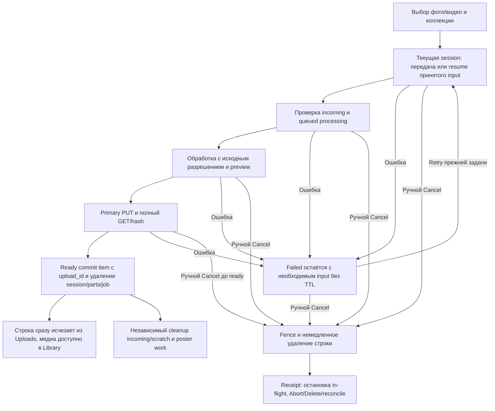

# UX/UI-аудит и согласованный целевой интерфейс

Статус: исходный аудит Angular от 10 ноября 2026 сохранён как историческое основание. 14 ноября 2026 владелец одобрил текущий макет v27 и всё его пользовательское поведение как целевой UI production-версии (D-16): [макет](prototype/README.md), [паспорт согласованной версии](prototype/accepted-baseline.json). Единый viewer D-14, минимализм D-12, английский UI D-13 и очередь D-15 входят в этот baseline. Подтвержденная продуктовая рамка — личная медиатека для одного пользователя, браузер на том же современном Mac с Docker Desktop, несколько тысяч материалов и около 100 GB медиа, сохранение существующих возможностей. Основная приемка — desktop Safari и Chromium, доступность с клавиатуры Mac и работа без внешнего интернета после получения обоих контейнерных образов. Мобильный и LAN-доступ в v1 не обязательны. Production-интерфейс не реализован; изменения старого приложения в эту работу не входят.

Главная UX-задача rewrite — сделать связными три действия: найти нужный материал, просмотреть его в контексте найденного и организовать библиотеку. Для этого приняты явные состояния, URL/Back-контекст поиска и просмотра, понятный результат изменения данных. Отдельной истории поисков или действий в согласованном UI нет. Существующие категории — сохраненные поисковые условия, а коллекции — явная принадлежность материала одной коллекции. В согласованной модели коллекция похожа на папку, теги дают множественную классификацию; структура остается плоской.

После просмотра первого макета владелец подтвердил D-12: **минимализм с акцентом на медиа и теги, как в текущем приложении**. Это правило заменяет прежние рекомендации о постоянной metadata-панели и обучающих текстах. У готового медиа нет названия; вымышленные title/filename первого макета не описывали текущую модель. В галерее, list и едином просмотре убираются названия, технические сведения, описания, постоянные syntax/keyboard hints, слоганы, guides и метки «Готово». Остаются контент, теги и компактные действия навигации/редактирования/favorite/коллекции. Длительность и controls видео допустимы. Помощь открывается по запросу, ошибки и progress показываются только в соответствующей ситуации. Сохранность legacy metadata и работа backend при этом не меняются.

D-13 уточняет язык и controls: **весь интерфейс и демо-контент на английском, как в legacy**. Это включает ошибки, empty states, подсказки по запросу, tooltips и accessible names, а в демо — теги, коллекции и сохранённые поиски. Типы представлены двумя независимыми Image/Video icon-toggle; Sort — icon-trigger и меню семи пунктов с иконками, Add — icon-only только в Uploads. В галерее нет Add/upload shortcut и search-help `?`; sidebar Uploads остаётся. English labels в открытом меню допустимы; постоянные type/sort selects не используются. Icon-only сохраняет focus, keyboard-доступ, accessible name/tooltip и выбранное/expanded state. Исследовательская документация остаётся на русском: русские названия сценариев и объяснения ниже описывают смысл, а не предлагают русскую локализацию продукта. Реальные пользовательские данные не переводятся, Unicode остаётся допустимым; языковой switch не добавляется.

D-14 от 12 ноября 2026 подтверждает **один просмотр: медиа сверху, теги и вторичная информация под ним**, как в legacy content-page. Из grid, list и related открывается один canonical viewer; отдельный quick-preview и правая панель не нужны. Под контентом доступны теги, компактные favorite/edit/navigation и группа одной коллекции; контекст origin сохраняется в URL/Back без обязательной постоянной подписи saved search. Category остаётся сохранённым запросом, не назначением материала. Все действия прежних двух flows сохраняются в общем viewer; Back возвращает query/type/sort/page/scroll, prev/next сохраняет контекст. Учёт — один логический event после 3 секунд открытия viewer; thumbnails/list сами просмотр не создают. Preview/poster assets обработки и сетки остаются: это не второй UI. D-12/D-13 сохраняют минимализм и английские иконки; технические поля и description не возвращаются.

## Согласованный состав UI и границы backlog

Целевой состав — текущий v27, а не набор вариантов для последующего выбора. Описанные ниже взаимодействия v27, включая list selection и bulk replace, обязательны по D-16. Отдельно отмечены исторические наблюдения и оставшиеся предложения, которых в макете нет. Отсутствие настоящих CRUD/processing/сетевых ошибок в исследовательской реализации не отменяет production-функции F-01…F-38 или технические требования сохранности.

### Основа первого production релиза

| Область | Что меняется | Проверяемый результат |
| --- | --- | --- |
| Библиотека и поиск | Полная пагинация, компактный total/границы; поиск по тегам, без кнопки справки; ошибка только при неверном выражении | Все результаты, включая записи после первых 300, достижимы; нет постоянной syntax-подсказки, сохраняются язык запросов и семь сортировок. UX-03/UX-07 |
| Контекст навигации | URL хранит запрос, тип, сортировку и страницу; просмотр связан с контекстом выдачи, возврат восстанавливает scroll | Back/reload/прямая ссылка не теряют рабочее место; Random стабилен внутри выдачи и prev/next. UX-01 |
| Просмотр медиа | Один viewer из grid/list/related; медиа сверху, теги, группа коллекции и компактные controls ниже; origin хранится в URL/Back | Нет правой панели, отдельного quick-preview, title/filename, технических полей и описания; сохраняются Back/context, zoom/rotate, video hotkeys и правило 3 секунд. UX-04/D-12…D-14 |
| Загрузка | Uploads показывает pending/error и этапы передачи/обработки; ошибка остаётся до retry/cancel, ready/cancel сразу убираются | Одна автоматическая загрузка без выбора originals и подтверждений конвертации. Нет архива результатов или TTL; готовые медиа доступны в Library. 100% передачи не означает ready. UX-02/D-15 |
| Редактирование и list bulk | Теги chips + поиск, одна searchable коллекция, стабильный modal, отдельный draft; атомарная команда для одного item либо выбранных строк list | Cancel ничего не меняет; Save сохраняет оба поля у всех выбранных либо ни одного. Ввод/failure сохранены, pending блокирует повтор. Description остаётся в данных/API. UX-05/UX-06/D-12/D-16 |
| Организация | Одна коллекция как папка, несколько тегов; сохраненный фильтр остается отдельной сущностью; rename тега обновляет его выражение | Не добавляются вложенность, несколько коллекций и нормализация/слияние тегов; результаты сохраненного фильтра после rename прежние. UX-08 |
| Состояния интерфейса | Различаются пустая библиотека, нулевой поиск, загрузка, ошибка запроса, недоступное media и processing failure | Пустота не маскирует ошибку; пользователю понятен допустимый следующий шаг. UX-11 |
| Общий UI | Одна тема и система controls, отступов и типографики; адаптивная desktop-сетка, grid/list и семь уровней плотности; подписи действий, focus и клавиатура Mac | Фото/видео остаются основным содержимым; уменьшение окна и browser zoom не прячут действия; hover не является единственным доступом. UX-09/UX-12/UX-14 |

Для очереди используется английская подпись **`Uploads`**, чтобы не смешивать обычное добавление медиа с внешним переносом библиотеки. Принята отдельная страница из sidebar: pending/error сохраняются независимо от её открытия, ready/cancel сразу исчезают. Это не универсальный журнал изменений и не экран import/export. Остальные подписи: `Library`, `Collections`, `Tags`, `Categories`. В галерее поиск и type/sort controls остаются компактными; Add/Choose files находятся только в Uploads, tooltip/accessible name объясняет icon-action без постоянного текста над медиа.

Галерея в grid остаётся поверхностью просмотра: без checkbox/selection/bulk-toolbar, Add и search-help `?`. Выделение текущей страницы и массовая замена tags/collection только в list согласованы по D-16 и входят в целевой UI. Размер миниатюр в grid управляется двумя иконками `+`/`−` вместо slider: `+` увеличивает медиа/уменьшает число колонок, `−` уменьшает/увеличивает; семь уровней сохраняются, на границах кнопки disabled. В list controls размера не показываются.

Поле запроса и Photos/Videos/Sort/Clear filters находятся внутри одной рамки search form. Clear filters всегда виден, включая пустой фильтр; reset снимает query/type/collection/subset, возвращает page 1 и сохраняет sort/view. В макете controls используют одинаковые 32 px icon-buttons и одну семью иконок. `+`/`−` и Grid/List расположены справа снаружи search form, на одной строке desktop. Общий total активной выдачи перенесён в footer рядом с пагинацией под grid/list; это все найденные материалы, не 24 записи текущей страницы. На узком окне разрешён перенос групп без overflow; принадлежность фильтров search form сохраняется.

### Оставшиеся предложения к существующим операциям, вне v27

Эти дополнительные UI-входы не показаны в одобренном v27 и не становятся обязательными только из-за аудита. Сами существующие API и прежние рабочие CRUD workflows сохраняются:

| Дополнение | Что получает пользователь | Граница реализации |
| --- | --- | --- |
| «Создать тег» на странице тегов | Возможность начать классификацию без ручного API-запроса | Существующее создание и rename; создание прямо из editor можно добавить позднее |
| «Сохранить поиск» у текущей выдачи | Создание категории без повторного ввода query/type | Точка входа имеющегося CRUD; видимое название раздела — `Categories`, без изменения модели |
| Удаление материала из меню | Доступ к имеющейся операции без ручного API | Предлагается конкретное подтверждение необратимости; корзины/Undo нет. Это не подтверждение автоматической конвертации Upload |

List selection и общая массовая замена больше не относятся к этому списку: их уже одобрил владелец. Create-tag entrypoint, shortcut сохранения поиска и новое меню удаления остаются отдельными предложениями; отсутствие кнопок в v27 не отменяет существующие операции и UI CRUD из F-реестра. Неработающие кнопки не допускаются.

### Что требует нового контракта и остается отдельным backlog

**«Избранное» как рабочий фильтр** — полезное следующее дополнение, но оно требует серверной фильтрации по всей библиотеке и согласования pagination/navigation context. Существующие флаг, кнопка и индикация сохраняются; фильтрация только загруженной страницы не заменяет Favorites view. До реализации ложный пункт навигации не показывается.

Массовые add/remove тегов, выбор всех совпадений через страницы, редактор description, удаление тега с обработкой зависимых фильтров, visual query builder, полнотекстовый поиск, общий history/Undo, ручные covers/order и дополнительные viewers не включаются автоматически. Блок «Сведения о библиотеке» — отдельная предлагаемая поверхность над production diagnostics; отсутствие места или хранилища уже должно объясняться в соответствующей операции. Управление backup/restore, архив originals, корзина и расширение модели коллекций остаются за пределами принятых требований.

Согласован [интерактивный макет v27](prototype/README.md), объединяющий библиотеку с результатами поиска, полный просмотр с редактором и pending/error очередь Uploads без истории. Сквозной сценарий: найти → открыть → изменить теги/коллекцию → вернуться в ту же выдачу; отдельно — добавить пакет и разобраться с ошибками. Автоматическая проверка его взаимодействий описана в разделе 7; usability test с пользователем еще не проводился.

## 1. Основания и ограничения

Для аудита существующего приложения использованы Angular TypeScript, шаблоны, SCSS, маршруты, state/API services и отдельные backend-контракты, от которых зависит смысл интерфейса. Производственные данные не читались; старое приложение не запускалось. Поэтому выводы о нем ниже основаны на коде, без утверждений о наблюдавшихся в нем переполнениях, измеренном контрасте или проверке скринридером. Позднее отдельно запущен браузер для нового автономного UX-макета на синтетических данных; это не меняет статус исходного аудита.

Обозначения:

- **Факт** — непосредственно следует из указанного исходника; это не результат выполнения сценария.
- **Риск/гипотеза** — предполагаемое UX-последствие, которое нужно проверить на синтетических данных в браузере.
- **Подтвержденное решение** — ответ пользователя, задающий рамки rewrite.
- **Предложение/backlog** — явно отмеченный вариант вне v27 и принятых D-решений; **целевой контракт** — согласованное поведение v27 либо сохранённый production-паритет, а не статус исторической гипотезы.

Подробный функциональный реестр и различия API/UI находятся в [01-current-behavior.md](01-current-behavior.md). Связанные группы: F-08–F-11/F-34 — поиск; F-12–F-15 — представления и просмотр; F-16–F-21 — теги; F-22–F-28 — категории/коллекции/связанные материалы; F-29–F-31 — favorite/views/delete; F-33 — preferences; F-02–F-07/F-37 — импорт. Этот документ описывает пользовательскую модель и критерии приемки интерфейса, согласованные с [целевой архитектурой](03-target-architecture.md), [эксплуатацией/миграцией](04-migration-and-operations.md) и [выбором S3-хранилища](08-s3-storage-decision.md).

### Подтвержденные решения и пределы предложений

- Новые Upload принимают только фото/видео. Сохраняется исходное разрешение; в библиотеке остаются готовая версия и preview без дополнительного original. Конвертация, сохранение и проверка результата, затем удаление временного upload-исходника идут автоматически. Источник удаляется только после PUT canonical, полного GET с совпавшим хешем и commit состояния ready в SQLite. Для пользователя это одна операция Upload без промежуточных подтверждений, с допустимыми progress/error.
- Выбраны два контейнера: modular monolith TagFiles с SQLite и SeaweedFS 4.53 в режиме `mini`, с embedded LevelDB2 и глобальным правилом fsync для всех путей. Браузер работает только с локальным origin приложения; S3 остается внутренним. Приложение потоково проксирует Upload через native S3 multipart upload в durable incoming. Эти механизмы определяют надежность и диагностику, но не добавляют пользовательских шагов, выбора bucket, путей хранения или ввода S3 credentials.
- Старые Unknown/Text/Audio, их файлы, metadata и фильтры сохраняются при переносе. Ограничение новых загрузок не разрешает терять legacy-данные; новые audio/text viewers не добавляются автоматически.
- Удаление материала окончательное, без корзины. Ответ «без подтверждений» относится к этапам Upload. Подтверждение перед новой UI-кнопкой удаления материала ниже остается UX-предложением, отдельно от подтвержденной окончательности операции.
- На материал приходится ноль или одна коллекция и несколько тегов; вложенность не вводится. Rename тега обновляет сохраненные фильтры категорий, сохраняя тот же набор найденных материалов. Удаление коллекции убирает группу и снимает членство, сами материалы сохраняются.
- Библиотекой управляет TagFiles; интеграция с Finder не требуется. Migration/import/export и backup/restore выполняются инструментами вне кода основного сервиса, без встроенных CLI/API/UI/scheduler. Миграция — одноразовый внешний скрипт; backup обеспечивает пользователь, возможны отдельный скрипт и инструкция. Допустим полный offline-copy с остановкой и дополнительной копией около 100 GB.
- По D-16 текущий v27 фиксируется как целевой UI/поведение. Исторические факты Angular остаются фактами; отвергнутые варианты и отсутствующие в v27 новые функции — отдельный backlog. Приоритет P0/P1 сам по себе не включает такой backlog.
- D-12 подтверждает визуальную сдержанность: медиа не имеет пользовательского названия, техническая информация и постоянные пояснения не занимают галерею/viewer. Подписи controls для доступности сохраняются. Временное входное имя допустимо лишь для сопоставления передачи или ошибки в очереди, не у готового медиа.
- D-13 фиксирует английский язык интерфейса/демо и иконки типа/сортировки/добавления. Image и Video — независимые toggle: `10` фильтрует Image, `01` — Video, `00/11` дают all, сохраняя различимое состояние обеих кнопок. Sort-menu содержит `Uploaded ↓/↑`, `Duration ↓/↑`, `Views ↓/↑`, `Random`; выбранный пункт, focus и Escape проверяются отдельно.

Полный реестр решений — [06-product-questions.md](06-product-questions.md). Uploads в согласованной навигации означает обычное добавление фото/видео и обработку файлов; миграция legacy-библиотеки остается внешней операцией.

### Техническая рамка реализации AI-агентами

Переписывание будут выполнять AI-агенты. Рекомендуемый новый стек — Go 1.27.4 и React 19.3.1 + Vite 8.3 + TypeScript strict; Node 26 нужен только при сборке статической SPA. Решение и сравнение альтернатив приведены в [исследовании прикладного стека](09-application-stack-decision.md). Упоминания Angular, LightGallery и video.js ниже остаются фактами о прототипе, а не рекомендацией переносить его пакеты. Знакомство человека с Angular не является главным критерием выбора; оснований обещать более качественный React-код от AI нет.

Для единообразной реализации предлагается один готовый UI kit: Mantine `core`/`hooks`/`form` одной закрепленной версии, CSS modules и общий theme. Стандартные Modal, Combobox для tag chips и одного collection select, Table, Pagination и поля форм уменьшают объем собственной композиции controls; thin feature components сохраняют предметные правила тегов/коллекций. `useForm` владеет отдельным draft, dirty и field errors. Готовый kit не заменяет проверки VoiceOver, имен кнопок и focus в конечных сценариях. Дополнительные headless kits, Tailwind, RHF, Zod и глобальный state manager в baseline не требуются. [Mantine с Vite](https://mantine.dev/guides/vite/), [формы](https://mantine.dev/form/use-form/), [доступный Modal и управление focus](https://mantine.dev/core/modal/).

React Router Data mode отвечает за маршруты, ошибки переходов и восстановление scroll; TanStack Query — единственный cache серверных данных и polling результатов. Route loaders могут использовать тот же Query cache. Search state принадлежит URL, локальные preferences — versioned browser state, draft — форме. Это предотвращает смешение query cache, текущего фильтра и несохраненного редактирования. Генерируемые OpenAPI-типы и клиент, явные feature boundaries и воспроизводимые проверки задают правила для агентов; SSR, Node server, второй server-state store и собственная универсальная дизайн-система не входят в рекомендацию. Они реализуют принятый UI v27; не добавляют отсутствующие в нём новые экраны/shortcuts из исторического backlog.

### Карта источников

Ссылки отсчитываются от `docs/rewrite/`.

| Код | Что проверено | Исходники |
| --- | --- | --- |
| E01 | Маршруты и оболочка | [routes](../../tag-files-web-app/src/app/app.routes.ts), [app template](../../tag-files-web-app/src/app/app.component.html), [app SCSS](../../tag-files-web-app/src/app/app.component.scss) |
| E02 | Главная навигация и загрузка | [sidebar TS](../../tag-files-web-app/src/app/components/sidebar/sidebar.component.ts), [template](../../tag-files-web-app/src/app/components/sidebar/sidebar.component.html), [SCSS](../../tag-files-web-app/src/app/components/sidebar/sidebar.component.scss) |
| E03 | Глобальный поиск, фильтры, сортировка | [search bar TS](../../tag-files-web-app/src/app/components/search-bar/search-bar.component.ts), [template](../../tag-files-web-app/src/app/components/search-bar/search-bar.component.html), [search state](../../tag-files-web-app/src/app/services/search.service.ts), [sort types](../../tag-files-web-app/src/app/services/api/sort-type.ts) |
| E04 | Настройки представления и header | [app state](../../tag-files-web-app/src/app/services/app-state.service.ts), [header TS](../../tag-files-web-app/src/app/components/header/header.component.ts), [template](../../tag-files-web-app/src/app/components/header/header.component.html), [SCSS](../../tag-files-web-app/src/app/components/header/header.component.scss) |
| E05 | Библиотека, сетка и список | [library TS](../../tag-files-web-app/src/app/pages/library-page/library-page.component.ts), [template](../../tag-files-web-app/src/app/pages/library-page/library-page.component.html), [grid TS](../../tag-files-web-app/src/app/components/image-grid/image-grid.component.ts), [grid template](../../tag-files-web-app/src/app/components/image-grid/image-grid.component.html), [list TS](../../tag-files-web-app/src/app/components/image-list/image-list.component.ts), [list template](../../tag-files-web-app/src/app/components/image-list/image-list.component.html) |
| E06 | Детальный просмотр, соседние и похожие материалы, счетчики | [content TS](../../tag-files-web-app/src/app/pages/content-page/content-page.component.ts), [template](../../tag-files-web-app/src/app/pages/content-page/content-page.component.html), [SCSS](../../tag-files-web-app/src/app/pages/content-page/content-page.component.scss), [navigation context](../../tag-files-web-app/src/app/services/navigation-context.service.ts), [similar handler](../../tag-files-service/TagFilesService.Library/Handlers/GetSimilarLibraryItemsHandler.cs) |
| E07 | Видеоплеер | [player TS](../../tag-files-web-app/src/app/components/video-player/video-player.component.ts), [template](../../tag-files-web-app/src/app/components/video-player/video-player.component.html) |
| E08 | Загрузка и состояния обработки | [upload TS](../../tag-files-web-app/src/app/components/upload-dialog/upload-dialog.component.ts), [template](../../tag-files-web-app/src/app/components/upload-dialog/upload-dialog.component.html), [SCSS](../../tag-files-web-app/src/app/components/upload-dialog/upload-dialog.component.scss), [processing API](../../tag-files-web-app/src/app/services/api/files-processing-api.service.ts) |
| E09 | Редактирование материала | [editor TS](../../tag-files-web-app/src/app/pages/library-item-edit-modal/library-item-edit-modal.component.ts), [template](../../tag-files-web-app/src/app/pages/library-item-edit-modal/library-item-edit-modal.component.html), [tags form TS](../../tag-files-web-app/src/app/components/tags-form/tags-form.component.ts), [template](../../tag-files-web-app/src/app/components/tags-form/tags-form.component.html), [collection selector](../../tag-files-web-app/src/app/components/select-collection/select-collection.component.html) |
| E10 | Теги и их статистика | [tags table TS](../../tag-files-web-app/src/app/components/tags-table/tags-table.component.ts), [template](../../tag-files-web-app/src/app/components/tags-table/tags-table.component.html), [tag editor](../../tag-files-web-app/src/app/pages/tag-edit-modal/tag-edit-modal.component.ts), [tags API](../../tag-files-web-app/src/app/services/api/tags-api.service.ts) |
| E11 | Категории как сохраненные запросы | [categories TS](../../tag-files-web-app/src/app/pages/categories-page/categories-page.component.ts), [template](../../tag-files-web-app/src/app/pages/categories-page/categories-page.component.html), [editor TS](../../tag-files-web-app/src/app/pages/category-edit-modal/category-edit-modal.component.ts), [editor template](../../tag-files-web-app/src/app/pages/category-edit-modal/category-edit-modal.component.html) |
| E12 | Коллекции | [overview TS](../../tag-files-web-app/src/app/pages/collections-page/collections-page.component.ts), [overview template](../../tag-files-web-app/src/app/pages/collections-page/collections-page.component.html), [collection TS](../../tag-files-web-app/src/app/pages/collection-page/collection-page.component.ts), [template](../../tag-files-web-app/src/app/pages/collection-page/collection-page.component.html), [editor TS](../../tag-files-web-app/src/app/pages/collection-edit-modal/collection-edit-modal.component.ts) |
| E13 | Модель и доступные API-операции | [library API](../../tag-files-web-app/src/app/services/api/library-api.service.ts), [collections API](../../tag-files-web-app/src/app/services/api/library-collections-api.service.ts), [file types](../../tag-files-web-app/src/app/services/api/file-type.ts) |
| E14 | Реальная грамматика поиска | [converter](../../tag-files-service/TagFilesService.Library/TagQueryConverter.cs), [его тестовые примеры](../../tag-files-service/TagFilesService.Tests/Unit/Library/TagQueryConverterTest.cs), [search handler](../../tag-files-service/TagFilesService.Library/Handlers/SearchRequestHandler.cs) |
| E15 | Значение изменения тегов и терминальных состояний | [assign tags](../../tag-files-service/TagFilesService.Library/Handlers/AssignTagsHandler.cs), [processing list](../../tag-files-service/TagFilesService.FilesProcessing/Handlers/GetProcessingFilesHandler.cs), [delete collection](../../tag-files-service/TagFilesService.Library/Handlers/LibraryCollections/DeleteLibraryCollectionHandler.cs) |
| E16 | Тема, плотность и внешние ресурсы | [global styles](../../tag-files-web-app/src/styles.scss), [index](../../tag-files-web-app/src/index.html), [Angular configuration](../../tag-files-web-app/angular.json), [package](../../tag-files-web-app/package.json), [grid SCSS](../../tag-files-web-app/src/app/components/image-grid/image-grid.component.scss), [list SCSS](../../tag-files-web-app/src/app/components/image-list/image-list.component.scss) |

## 2. Исторические экраны Angular и сохраняемые целевые сценарии

### Экранная карта Angular: исторические факты

| Экран/элемент | Доступные действия и содержимое | Важная граница |
| --- | --- | --- |
| Общая оболочка | Фиксированный header с поиском; открываемый sidebar; `Library`, `Tags`, `Categories`, `Collections`; кнопка `Upload` внизу sidebar | `Favorites` показан текстом с иконкой, но без маршрута или обработчика (E01–E04) |
| `/library` | Сетка или таблица, изменение размера миниатюр в сетке, поиск, Image/Video, семь вариантов сортировки | Загружается первая страница до 300 материалов; пользовательского управления страницами и выделения файлов в исходниках нет (E03–E05) |
| `/content/:id` | Картинка или video.js; теги, избранное, число просмотров, редактор, предыдущий/следующий; другие материалы коллекции; похожие материалы | Контекст соседей хранится только в памяти; картинка и видео имеют разные клавиатурные действия (E06–E07) |
| Быстрый просмотр из таблицы | LightGallery открывает библиотечную копию картинки или видео; подключены плагины zoom, rotate, video | Это отдельный поток, не переход на `/content/:id`; настройки отключают download, счетчик, flip и часть rotate-controls (E05) |
| Редактор материала | Миниатюра, ID, дата, тип, длительность, путь; существующие теги с автодополнением и удалением chip; коллекция или отсутствие коллекции; Save | Сохраняется ровно один материал; тело API позволяет список ID, но UI массовой операции нет (E09, E13) |
| `/tags` | Тег, usage count, переход к поиску по тегу, переименование | Таблица не дает создать тег; create-ветка диалога/API существует, но входа в нее из этого экрана нет (E10) |
| `/categories` | Имя, tag query, тип файлов; применить категорию как поиск; создать, изменить, удалить с подтверждением | Это сохраненный фильтр, а не контейнер с файлами; выбор не сохраняет отдельную сортировку категории (E03, E11) |
| `/collections` | Карточки с обложками или fallback-иконкой, название, общее число, создание | Материал имеет один nullable `collectionId`, не произвольное множество коллекций (E12–E13) |
| `/collections/:id` | Имя, редактор коллекции, ее материалы сеткой; из редактора — переименование/удаление | Коллекция задает свой ordered navigation context; list-переключателя на этой странице нет (E12) |
| Диалог загрузки | Выбор нескольких изображений/видео, размер каждого, удаление из списка, выбор коллекции, проценты загрузки, список этапов обработки | Это локальный диалог; «Change files» заменяет выбранный список; обработка запрашивается общим списком сервера (E08) |

Пустой маршрут перенаправляет на `/library`. Отдельного экрана входа, ролей, командных пространств или полноценной страницы настроек текущие маршруты не содержат. Для заявленного single-user продукта вводить такие уровни навигации не требуется.

### Пути, которые нужно сохранить

1. **Найти и посмотреть.** Ввести тег/выражение → Enter или поиск → уточнить тип/сортировку → открыть сетку или таблицу → просмотреть материал → вернуться к тому же набору. В старом Angular запрос живёт в singleton-сервисе; устойчивое восстановление после перезагрузки URL не задано.
2. **Просматривать подряд.** Открыть материал сетки библиотеки/коллекции → предыдущий/следующий → теги, избранное, похожие и другие материалы коллекции. У последовательности есть источник и порядок, а не только пара случайных ID.
3. **Открыть медиа из списка и вернуться.** List, как grid и related, открывает единый viewer → zoom/rotate изображения или воспроизведение видео → Back возвращает прежние запрос, тип, сортировку, страницу, scroll и focus. По D-14 отдельный LightGallery quick-preview не переносится; его действия входят в общий viewer.
4. **Организовать один материал.** Открыть Edit из таблицы или меню детального просмотра → подобрать существующие теги → назначить/снять коллекцию → Save → увидеть обновленные данные в исходном контексте.
5. **Пользоваться классификацией.** Открыть тег с usage count или категорию с запросом → перейти к результатам; создать/изменить категорию; переименовать тег, не теряя назначений. Подтвержденное дополнение к прототипу: связанные фильтры категорий после rename находят те же материалы.
6. **Работать с коллекцией.** Создать коллекцию → выбрать ее при загрузке или редактировании материала → открыть коллекцию с обложкой → просмотреть соседей → переименовать/удалить коллекцию с понятным последствием.
7. **Загрузить пакет.** Выбрать фото/видео → выбрать коллекцию → запустить Upload → автоматически передать, обработать, сохранить и проверить результат → удалить временный upload-исходник → ошибки оставить до retry/cancel, успешные убрать из очереди и открыть медиа в библиотеке. Промежуточных подтверждений конвертации/сохранения/очистки нет; видимая обратная связь не добавляет ручных шагов.

## 3. Редкие и скрытые возможности: что именно сохранять

### Поиск и категории

**Факты (E03, E14).** Поиск выполняется по тегам, а не по имени файла, пути или описанию. Поддержаны `&&`, `||`, отрицание `!tag`, скобки; примеры в тестах включают `tag1 && (tag2 || tag3) && !tag4`. Токен тега в текущем converter ограничен латинскими буквами, цифрами и дефисом (`[a-zA-Z0-9\-]+`); кавычки, пробелы внутри имени, `_` и кириллица полноценными токенами этой грамматики не представлены. Это ограничение **языка запроса**, не доказательство запрета таких имен при создании тегов. Текущий converter извлекает совпадения regex, поэтому нельзя обещать понятную диагностику любого неподдерживаемого ввода.

Оба включенных переключателя Image/Video и оба выключенных означают отсутствие фильтра типа, включая возможные Unknown; один включенный означает ровно Image или Video. Это не объединение только изображений и видео. Clear очищает запрос и эти два переключателя, но оставляет текущую сортировку. Переход по тегу сбрасывает типы и оставляет сортировку; категория меняет запрос и тип, также оставляя сортировку. Сортировки: дата загрузки ↑/↓, длительность ↑/↓, число просмотров ↑/↓, случайный порядок.

**Целевой контракт D-12/D-13/D-16.** В отличие от описанного выше Angular-перехода, клики имён tag/category/collection в v27 создают свежую выдачу UploadedDesc/page 1 с текущим grid/list: tag — точное имя без старых type/collection/subset, category — свой query/type, collection — своё членство. Back viewer сохраняет sort/page исходного origin. Clear сохраняет sort/view, но снимает query/type/collection/subset и возвращает page 1.

Совместимый расширенный язык сохраняется, ошибка выражения объясняется рядом с полем. Search-help control в галерее отсутствует. Два независимых Image/Video icon-toggle сохраняют четыре boolean-состояния; `00/11` означают all, отдельный type select и постоянная итоговая подпись не требуются. Системные имена `Search by tags` и `Categories` английские. До расширения допустимых имен/кавычек нужны миграционные и паритетные проверки; новое поведение должно быть явно версионировано. Обычный выбор существующих тегов генерирует то же выражение, не вводя второй поисковый движок.

**Подтвержденный контракт.** Переименование тега обновляет связанные фильтры категорий, сохраняя их результат на неизменной библиотеке. Сравнение имен остается binary case-sensitive; имеющиеся дубли не запрещаются новым требованием уникальности. Расширение синтаксиса и новая политика имен остаются отдельными предложениями.

### Представления и просмотр

**Факты (E04–E07).** Sidebar open/closed, grid/list и уровень размера миниатюр сохраняются в `localStorage`. Уровни 1–7 отображаются в 10–4 колонки; это фиксированное число колонок, а не адаптивный размер карточки. Миниатюры картинки пусто подписаны `alt=""`; tags доступны tooltip сетки и chip таблицы. На сетке показаны длительность видео и маркер избранного. Наличие метода toggleFavorite в grid-классе не означает доступную кнопку: шаблон его не вызывает. Избранное переключается на странице материала.

Grid библиотеки и отдельной коллекции записывает в NavigationContextService список ID текущего набора. Сетки похожих материалов и соседей коллекции на detail-page такой список не передают. При прямом открытии URL/перезагрузке память контекста пуста. Клавиши ←/→ у картинки переключают материал; у видео — перематывают на −3/+5 секунд. Пробел у видео play/pause, ↑/↓ меняют громкость на 0,1. Плеер выставляет громкость 0,5; настройки детального видео запрашивают autoplay, а результат реального autoplay зависит от браузера. В legacy есть два UI-пути: самостоятельный detail и быстрый preview с zoom/rotate. D-14 объединяет их в один viewer, сохраняя действия.

«Похожие» в текущем backend означает другие материалы с **ровно тем же непустым набором тегов**, в порядке даты загрузки по убыванию (E06/F-28). Это не визуальная похожесть, embedding-поиск или пересечение по одному тегу. Для материала без тегов блок пуст. Подпись «С такими же тегами» точнее объясняет существующий результат; переход к другой модели сходства — отдельная новая функция.

Согласованный заголовок `Same tags` кликабелен: он открывает обычную галерею с AND всех имён тегов материала (`tag1 && tag2`), сортировкой новые первыми (`uploadedDesc` в URL макета) и первой страницей; type, collection и subset загрузок сбрасываются. Это **не exact-set выдача**: галерея включает текущий материал и материалы с дополнительными тегами. Сама related-секция сохраняет точное равенство непустых наборов tag ID и исключает текущий материал. Группа коллекции остаётся перед `Same tags`, с одним кликабельным именем без дубликата у тегов и без отдельного `All`.

**Подтверждённый контракт D-14.** Один viewer с постоянной ссылкой из grid/list/related: медиа занимает основную ширину, теги/группа коллекции и компактные actions идут ниже; origin хранится в URL/Back без постоянного дополнительного label. Состояние хранит origin, выражение/фильтры, стабильный порядок ID или воспроизводимую страницу, текущую позицию и место возврата. Back восстанавливает query, оба type-toggle, sort, page, scroll и focus. Компактного «12 / 84» достаточно для соседей; постоянный текстовый разбор контекста не нужен. Для нового входа из похожих меняется origin; случайная сортировка не перетасовывает активную последовательность после favorite/save. Прямой URL работает без origin, отсутствие последовательности не мешает просмотру. Отдельного overlay quick-preview и правой панели нет.

**Согласованная группировка действий v27.** Компоновка, предложенная 13 ноября и одобренная в D-16, разгружает скопление кнопок справа. Размер области медиа — `80dvh`. Действия разделены по смыслу:

- **Навигировать:** строка под медиа содержит Back слева — узнаваемую стрелку влево с хвостом. Previous/position/Next находятся в центре; Previous и Next — симметричные chevrons одного рисунка и размера. Справа только icon-trigger `Image tools` для изображения.
- **Настроить изображение:** четыре controls zoom out/reset/zoom in/rotate скрыты по умолчанию в одной панели `Image tools`, открываемой кликом или клавиатурой под контентом. Доступ не зависит от hover; Escape закрывает панель и возвращает focus к trigger; клик снаружи также закрывает её. Английские accessible names/tooltips и expanded state сохраняются. У видео остаются его media-controls.
- **Организовать:** Edit и favorite находятся в строке выше тегов, слева рядом с Back. Следующая строка содержит теги без отдельной подписи/ссылки коллекции. Коллекция представлена только заголовком своей группы связанных материалов ниже, перед `Same tags`: текст заголовка — само имя коллекции, ссылка открывает её страницу; префикс `In collection` и отдельное действие `All` не нужны. При `collectionId != null` заголовок группы остаётся видимым, даже если других материалов в ней нет; без коллекции группа отсутствует. Выбранный favorite меняет только цвет/заливку SVG-звезды: фон, рамка и контур кнопки не получают selected style. `aria-pressed`, английское доступное имя и обычный focus-ring сохраняются. Правой информационной панели нет; origin сохраняется в URL/Back, без отдельного постоянного блока.

Постоянно видны шесть действий у изображения: Back, Edit, favorite, Previous, Next и Image tools; у видео — пять, без Image tools. Группировка не меняет canonical URL, Back/context, правила клавиш и учёта просмотров. Скрытие image-tools за одним trigger сохраняет все прежние действия и не добавляет новый плеер или новые функции.

**Технический кандидат, не результат браузерной проверки.** `yet-another-react-lightbox` (YARL) содержит Zoom, Rotate, Video и Inline plugins; Inline рассматривается для одного встроенного viewer по D-14. Rotate поворачивает image на 90°, учитывает размещение повернутого кадра и совместим с Zoom; Video использует нативный `<video>`. Выбор закрепляется после feature gate единого пути из grid/list/related: zoom/rotate и controls без жестов, точные video shortcuts, остановка старого звука, autoplay fallback, prev/next и Back с server navigation context, focus, accessible names и VoiceOver. Overlay quick-preview не нужен. Отсутствие poster не скрывает primary. Выбор пакета должен воспроизводить все принятые controls v27; дополнительные отсутствующие действия из backlog не включаются автоматически. [Plugins YARL](https://yet-another-react-lightbox.com/plugins), [Rotate](https://yet-another-react-lightbox.com/plugins/rotate).

Keyboard/ARIA defaults кандидата требуют явной настройки: controller ARIA включается и проверяется в конечном контексте; shortcuts не перехватывают editor и системные команды. В частности, Zoom документирует `⌘+`/`⌘−`/`⌘0`, которые должны оставаться browser zoom по контракту этого аудита. Клавиши изображения, zoom/pan и video не должны одновременно выполнять разные действия; Previous/Next остаются доступны кнопками. [Настройки controller/ARIA](https://yet-another-react-lightbox.com/documentation), [Zoom и клавиатура](https://yet-another-react-lightbox.com/plugins/zoom). Один пакет UI kit сам по себе не является достаточным основанием для выбора viewer: все обязательные функции подтверждаются отдельно.

### Теги на миниатюрах: выбран B с простым текстом

Пользователь выбрал вариант B с уточнением: теги на media-cards и related thumbnails показываются **только по hover или keyboard focus**, обычным неинтерактивным текстом через `·`. В покое миниатюра показывает медиа без постоянного ряда тегов. Popup содержит все теги, без chips, ссылок и `+N`; длинный набор может переноситься, все шесть имён не нужно вмещать в одну строку. Теги в viewer и list сохраняют прежнее кликабельное поведение. Это уточнение минимализма D-12 без нового D-ID и изменения модели данных.

[Сравнение A/B/C](prototype/tag-layout-options.html) остаётся историческим материалом выбора; прежняя рекомендация A больше не действует. Итоговые различия:

| Вариант | Представление | Статус и ограничение |
| --- | --- | --- |
| A | Постоянная строка: до двух тегов и `+N` с popup | Не выбран; заметнее теги, но больше постоянного UI |
| **B — выбран с уточнением** | В покое медиа; все теги plain text через `·` в popup по hover/focus | Нет chips или действий по тегам; обнаружение и keyboard-доступ нужно проверить |
| C | Постоянный простой текст через `·`, многоточие и popup | Не выбран; меньше плашек, но текст остаётся под каждой карточкой |

Popup обычно плавает **ниже** миниатюры; у нижней границы окна он переносится выше, чтобы весь текст оставался видимым. Открытие не меняет размеры карточек, рядов или grid. Между медиа и popup остаётся небольшой визуальный зазор, который не прерывает hover-путь; указатель можно перевести на popup без его исчезновения. Полный текст не обрезается контейнером или краями окна, положение и перенос проверяются у крайних карточек и при узком окне. Keyboard focus карточки также открывает popup, Escape закрывает его без переноса focus; область остаётся доступной при работе с ней. Требования закрываемости, hoverable и persistent объяснены в [W3C WCAG 2.2, SC 1.4.13](https://www.w3.org/WAI/WCAG22/Understanding/content-on-hover-or-focus.html). Они не считаются выполненными одним CSS hover. Same tags остаётся кликабельным AND-переходом, группа коллекции по-прежнему первая и не дублируется у тегов.

### Редактор тегов и коллекции: поиск с клавиатуры

Типичный набор пользователя — 20–30 тегов и несколько сотен коллекций; длинные checkbox-списки и обычный select первого макета затрудняли подбор. В legacy tags-form уже есть выбранные chips, input/autocomplete с `toLowerCase().includes`, исключением назначенных имён и выбором только существующего тега. Legacy select-collection содержит обычный MatSelect с typeahead, без отдельного полноценного substring search; новый поиск коллекции в редакторе — улучшение нашего макета, а не утверждение о прежнем input.

Редактор сохраняет selected tag chips + поиск. Коллекция выглядит как выбор одного значения: одно searchable single-select поле с именем выбранной коллекции, chevron и inline clear для `No collection`, без chip и отдельного поискового input. Новая коллекция заменяет прежний draft ID; nullable-выбор не становится multiselect. Оба поля локально фильтруют существующие имена по case-insensitive подстроке, храня выбор по ID отдельно от query. Ввод сам не назначает материалу тег/коллекцию и не создаёт тег. ArrowUp/Down перемещают активную option, Enter подтверждает выбор; Enter без активной option и запятая в tag search подтверждают только существующее совпавшее имя, не создают новый тег и не выполняют Save. Escape закрывает popup, Tab переводит focus без неявного выбора. Неподтверждённый query коллекции при Escape/Tab/blur восстанавливается в label выбранного draft ID либо `No collection`. Cancel ничего не сохраняет; Save failure оставляет draft и ввод тегов, а label коллекции соответствует подтверждённому draft ID. Pending Save блокирует поля, chips, повтор и закрытие формы до исхода; до Save Cancel/Close, backdrop и Escape при закрытом popup отклоняют draft и возвращают focus. Серверная binary/case-sensitive семантика и полная replace-операция тегов сохраняются.

Диалог не прыгает при focus, вводе, clear или выборе: внешний responsive bounding box одинаков при закрытом popup и при 0/350 результатах. Результаты — floating popup поверх формы вне layout flow, с собственной прокруткой, max-height 220px, viewport clamp и открытием выше поля при нехватке места снизу. Overflow диалога не обрезает dropdown; колесо/trackpad внутри результатов прокручивает только их, не вложенную форму или страницу. При переполнении chips/полей прокручивается тело формы, header/footer не меняют положение; Cancel/Save остаются доступны и при малой высоте окна. Это исправляет изменение размера первой поисковой версии редактора, без новых зависимостей или смены моделей.

На Collections поле `Search collections` live фильтрует всю локальную коллекцию имён по буквальной case-insensitive подстроке, с clear, no-match и footer shown/total. Компактная cover-сетка сохраняется; filter восстанавливается из `#/collections?search=…` при Back/reload. GET collections обязан вернуть весь справочник до frontend filter; API search/pagination для первых нескольких сотен коллекций не требуется, пагинация медиа внутри коллекции не меняется. Для приёмки используется отдельная инъекция 30 тегов/350 коллекций; исходное демо остаётся 8 тегов/3 коллекции. Это часть согласованного baseline D-16 поверх D-12/D-14, без смены моделей; D-15 Uploads не затрагивается.

### Выделение и массовые операции

**Факт (E05, E09, E13, E15).** Текущий Angular не содержит пользовательского выделения нескольких материалов, select-all или bulk toolbar. API принимает `itemsList` для тегов и назначения коллекции, но editor передает один ID. `assign-tags` заменяет полный набор тегов каждого материала; это не операция «добавить еще эти теги». Пользовательской пагинации тоже нет, хотя ответ API содержит `totalItems`, `pageIndex`, `totalPages`.

**Согласованный UI D-16.** Выделение и bulk toolbar раскрывают прежние API-возможности через общую атомарную команду tags + collection. Toolbar показывает `Selected: N`, `Tags and collection` и Clear selection; bulk editor явно сообщает `Replaces tags and collection for N items`. Начальный bulk draft — пустые теги и `No collection`, Save полностью заменяет оба значения у каждого выбранного item. «Добавить теги»/«Удалить выбранные теги» — отдельные будущие операции, требующие безопасного контракта, а не переименования replace-запроса. Массовый UI макета доступен только в list: сначала явное выделение видимых строк; grid не содержит checkbox/selection/bulk-toolbar. Выбора «все результаты» в baseline нет; смена page/filter/view и успешный Save очищают selection. Возможное будущее действие через все страницы потребует зафиксированного server set/количества; его нельзя молча ограничить первыми 300 материалами.

List имеет четыре колонки в порядке `Media`, `Tags`, `Collection`, `Actions`. В правой Actions-ячейке находятся icon `Edit media` и справа от него checkbox; место под них зарезервировано, hover/focus-within не вызывает reflow. В покое controls скрыты opacity, сохраняя Tab-доступ; focus строки раскрывает их. Checked checkbox остаётся видимым вне hover, чтобы выбор не терялся визуально. Edit media открывает существующий редактор одного материала прямо из list, без viewer/route change; Cancel сохраняет данные и возвращает focus к этой кнопке. Selection/bulk в grid не добавляются.

### Импорт, обработка и прогресс

**Факты (E08, E13, E15).** Загрузка проходит фазы `selecting → uploading → processing → done`. Для файлов есть `pending/uploading/done/error` и XHR-проценты передачи. Перед передачей запрашиваются URL по именам файлов, затем все выбранные файлы отправляются параллельно. Обработка опрашивается раз в 2,5 секунды. Отображаемые этапы: ожидание, converting, finalizing и другие значения серверного enum. Полный enum включает `WaitingForUpload`, `Pending`, `Converting`, `AddedToLibrary`, `TemporaryFileDeleted`, `LibraryItemSaved`, `Done`, `Failed`.

Статус обработки запрашивается для сервера в целом, не для конкретной загрузки. Handler исключает и Done, и Failed; UI определяет завершение по пустому списку и показывает «All files processed». Это историческое основание для явного **технического исхода каждой задачи**: по D-15 строка исчезает только после доказанного ready либо ручного cancel, а ошибка остаётся до действия пользователя. Отдельной истории успешных исходов UI не хранит. Нынешние проценты относятся к передаче байтов; они не являются процентом конвертации/всего импорта. Рисованный drop-zone — label для input; drag/drop-обработчиков в компоненте нет.

**Контракт D-15.** Uploads — только незавершённые и ошибочные задачи, не история. До ready видны передача/обработка, причина ошибки, Retry и ручной Cancel. Успешная строка исчезает сразу после проверенного primary и ready commit, отменённая — при fence; готовое медиа остаётся в библиотеке. Ошибки, receiving/idle и необходимые входы хранятся без TTL до успешного повтора либо отмены. Закрытие экрана/reload не теряет pending/error; после reload продолжение передачи может требовать выбора того же файла и совпадения fingerprint. При отмене независимый cleanup доводит Abort/Delete/late-response reconcile, не удерживая строку; cleanup retry готового item находится только во внутренней диагностике, а не Uploads. История пакетов, ready/Cancelled архив и подтверждение ознакомления не добавляются. Badge Uploads сохраняет прежний active count queued/running, failed не увеличивают его.

Для целевого native MPU hash worker обрабатывает ограниченные по памяти части, XHR передает `Blob`-части с byte progress в Safari; upload coordinator не принадлежит жизненному циклу диалога. Полный content fingerprint считается инкрементально, без чтения всего большого файла в RAM. После reload повторный выбор файла и совпадение fingerprint обязательны для переиспользования server parts; filename/size не доказывают совпадение содержимого. Query polling читает pending/error проекцию sessions/jobs; при отсутствии исполняющихся работ останавливается, после retry возобновляется. Ready восстанавливается при необходимости по item.upload_id, без истории. Эти детали обеспечивают надежность передачи и не добавляют optional pause/resume UI или обещания фоновой работы после закрытия браузера.

**Подтвержденный контракт.** Upload — одна операция: приложение принимает файл, обработка сохраняет исходное разрешение, создает готовую версию и preview, проверяет сохраненный результат и фиксирует готовность материала; только после этого автоматически удаляется временный источник. Проценты передачи байтов не означают, что файл уже надежно принят или готов к просмотру. Очередь обработки начинается после завершенной durable-передачи и сохранения серверной задачи. В UI нет выбора «сохранить original», ручного подтверждения конвертации, отдельного Save или подтверждения очистки. До проверки и фиксации готовности ошибка не обозначается как успех. Если последующая очистка временного источника не удалась, готовый материал остается доступным, а очистка получает отдельный статус и повтор без новой конвертации. Это обычная загрузка материалов, не встроенный инструмент миграции или восстановления библиотеки.

Принятая страница Uploads показывает `Total`, `In progress`, `Errors` и таблицу `Media`/`Uploading`/`Status`/actions: byte progress, этап, Retry ошибки и Cancel. Суммарный объём до старта, отдельный byte aggregate и сворачиваемая панель не показаны в v27 и не входят в согласованную компоновку; bounded concurrency и ошибки этапов остаются техническими требованиями. Процент конвертации не выдумывается. Совпадающие исходные имена различаются устойчивыми ID; имя не может быть идентичностью записи. Это целевой UX-контракт, не требование менять старый upload-dialog.

### Теги, коллекции, статистика и доступность операций

**Согласованная компоновка v27 от 14 ноября.** Три раздела следуют компактному виду legacy: Tags — таблица `Tag`/`Usage count`, Categories — `Name`/`Query`/`Items type`; имена кликабельны и создают новую галерею UploadedDesc/page 1 по tag query, category query + type либо collectionId; Back viewer сохраняет origin sort/page. Collections — auto-fill grid, min 160 px, квадратная cover, имя 14 px под ней, gap 12 px; пустые tracks не дают трём коллекциям занять всю ширину огромными cards. Описаний, больших зелёных панелей и отдельного `Open media` нет. Под каждым списком/сеткой — total числа сущностей. Это компоновка, а не новая модель или новая функция: управление сущностями в production сохраняется в объёме F-реестра, v27 не исполняет CRUD и мёртвых кнопок нет. Sidebar/rail 72 px, English UI и сохранение viewer/state остаются.

**Факты (E06, E09–E13).** Подбор тегов нечувствителен к регистру по подстроке для автодополнения; назначение через Enter/`,` разрешает только уже существующее точное имя. `New Tag...` сейчас не означает создание нового тега. В таблице тегов есть usage count и общий total; у категорий/коллекций есть total, у материала — viewCount. Обработчик на detail отправляет increment после 3 секунд нахождения материала на странице; он не привязан к фактическому старту видео или видимости вкладки. Модель содержит lastView и description, но данные поля не представлены отдельными действиями в текущем интерфейсе.

Создание тега поддержано API/диалогом, но не связано с доступным entrypoint; публичное удаление тега в текущем API не найдено. Удаление материала есть в API service, но не вызывается из шаблонов/страниц. Наличие `Unknown/Text/Image/Video/Audio` в enum не доказывает наличие audio/text viewer: picker принимает image/video, а detail/template выводит только Image и Video. Category editor использует все enum-значения; сохраненные категории с такими фильтрами нужно учитывать при переносе.

**Предложение.** Доступные «Создать тег» и, при необходимости, создание из автодополнения — новые входы к имеющемуся API создания, с сохранением существующего переименования и usage count. Страница избранного — новая пользовательская поверхность над существующим флагом; для настоящего фильтра по всей библиотеке понадобится соответствующий query-контракт, которого текущий SearchRequest не содержит. Это нельзя реализовать фильтрацией только загруженных 300 записей. API-only удаление материала можно раскрыть через меню; перед необратимой операцией предлагается конкретное подтверждение с указанием материала и удаляемых данных. Это новое UI-решение не следует из ответа об автоматическом Upload. Legacy Unknown/Text/Audio сохраняют теги и доступ к сохранённым данным/скачиванию; если inline-preview отсутствует, достаточно локального пояснения в этом состоянии, без постоянной технической панели. Сохранность файлов, description и metadata обязательна независимо от решения о viewer. Полноценные audio/text preview, редактор описания и история просмотров — возможное расширение, не обнаруженные действующие UI-функции и не обязательный паритет.

В принятом UI total найденного находится в footer выдачи, usage count — в Tags, total/shown — под организационным разделом. В viewer нет постоянного `N views`: viewCount/lastView хранятся и обслуживают сортировку/API, но не добавляют техническую информацию на просмотр. Правило учета просмотра в baseline сохраняется; переход к учету активного playback/видимой вкладки — отдельное согласованное изменение метрики. Не стоит одновременно менять правило и сравнивать новые счетчики со старыми как идентичные.

## 4. Системные UX-проблемы и целевые решения

Приоритеты исторического аудита: **P0** — паритет и доверие к основному действию; **P1** — снижение трения в частом сценарии; **P2** — последующая оптимизация. Целевые строки сверяются с v27/D-16; явно помеченный backlog не становится обязательным из-за приоритета и не требует исправлять старое приложение. Порядок конкретной реализации сверяется с [архитектурой](03-target-architecture.md) и [операционным планом](04-migration-and-operations.md).

| ID / приоритет | Проблема и свидетельство | Влияние и сценарий | Системное решение | Критерий приемки |
| --- | --- | --- | --- | --- |
| UX-01 · P0 | Контекст поиска и просмотра не выражен в адресе/истории; есть singleton state и in-memory ID context (E03, E06) | После открытия ссылки, reload, перехода к похожему человеку трудно понять, откуда он пришел и что означает «следующий» | URL описывает запрос/тип/сортировку/страницу; просмотр хранит origin и стабильную последовательность; явный Back без постоянных breadcrumbs над медиа | Back возвращает к тому же фильтру, sort, странице и позиции прокрутки; reload восстанавливает поиск; прямой material URL не требует предварительного входа в библиотеку |
| UX-02 · P0 | Старый active-list не показывает Failed и не доказывает ready (E08, E15) | Ошибка может исчезнуть без решения пользователя | D-15: pending/error очередь, готовность подтверждена item.upload_id, Retry/Cancel; без истории и TTL | Ready/cancel сразу исчезают, failed переживает reload/restart и время до retry/cancel; cleanup не удерживает строку |
| UX-03 · P0 | 300 записей и нет controls для остальных, хотя backend пагинирован (E03, E13) | Поиск и обход большой библиотеки воспринимаются как полный, часть материалов недоступна через текущую выдачу | Пагинация по 24, footer с общим total/границами; сохранение позиции при возврате; предсказуемый порядок | На synthetic-наборе >300 каждый результат достижим; «показано» и total различаются; смена фильтра начинает корректную страницу |
| UX-04 · P0 | Legacy имеет два способа просмотра с разными действиями (E05–E07); D-14 утверждает один | При объединении можно потерять zoom/rotate, теги, related или возврат | Один canonical viewer из grid/list/related, media-first layout с тегами/коллекцией ниже, scoped shortcuts | Все действия сохранены, Back возвращает query/type/sort/page/scroll; нет правой панели и отдельного quick-preview |
| UX-05 · P0 | Редактирование — несколько отдельных API-вызовов; UI не описывает pending/partial outcome (E09) | Человек меняет теги и коллекцию, закрывает форму или повторяет Save и не понимает сохраненный итог | Изолированный draft и один атомарный API commit tags + collection, как задано в спецификации | Cancel не меняет данные; Save блокирует дубль; failure сохраняет draft; успех означает сохранение всей формы, частичный Save не допускается |
| UX-06 · P0 для контракта, P1 для UI | В legacy bulk API есть, но семантика тегов — replace; selection UI отсутствовал (E13, E15) | Новая массовая форма может непреднамеренно стереть разные существующие теги | D-16: selection видимых строк только list, N и общий атомарный replace tags + collection. Add/remove — backlog | До старта видны N и последствия replace; контекст selection понятен; весь пакет сохраняется либо отклоняется без частичных изменений |
| UX-07 · P1 | Поиск содержит язык запросов по тегам (E03, E14) | Неясная область поиска или ошибка выражения мешают получить результат | Короткое имя поля, без search-help control и постоянных подсказок, ошибка рядом с неверным выражением | Совместимые запросы дают те же наборы; постоянного учебного блока нет; неполный запрос объяснён по ситуации |
| UX-08 · P1 | Category, tag и collection несут разный смысл, но не объясняют друг друга (E09–E12) | При наведении порядка человек выбирает между «положить в коллекцию» и «сохранить условия» без ясной модели | Раздельные разделы `Collections` и `Categories`, управление тегами; компактный контекст выдачи | Имена открывают соответствующие результаты; рабочие CRUD сохраняются по F-реестру, без постоянного блока над медиа |
| UX-09 · P1 | Действия скрыты hover/иконками; global key handlers не проверяют контекст input/dialog (E05–E07, E10–E11) | Работа клавиатурой менее обнаружима; фокус формы конкурирует с просмотром | Семантические кнопки и имена, `focus-visible`/`focus-within`, scoped Command shortcuts, явные меню действий | Все основные пути проходятся клавиатурой Mac в Safari/Chromium; в форме стрелки/пробел принадлежат форме; Escape закрывает верхний overlay и возвращает фокус |
| UX-10 · P1 | Часть операций API не имеет UI-входа, Favorites выглядит пунктом навигации (E02, E10, E13) | Человек видит неработающее направление или не может начать создание классификации | Существующие API/UI сохраняются; новые create-tag entrypoint и Favorites filter — backlog, ложный пункт Favorites не показывается | Сохраняются API создания тега и рабочий CRUD категорий/коллекций; каждый показанный пункт действует, новые UI-entrypoints за пределами v27 отмечены отдельно |
| UX-11 · P1 | Статусы данных распределены по шаблонам: пустая библиотека дает No search results, часть списков при пустоте не рисуется (E05, E10–E12) | Первый запуск, отсутствие совпадений, загрузка и недоступный сервер выглядят неоднозначно | Общий контракт empty/loading/error/stale/success; CTA по причине; статусы локальны соответствующему блоку | Первый запуск зовет загрузить файлы; нулевой поиск — изменить фильтр; error дает повторить; пустые related-блоки не маскируют ошибку основного материала |
| UX-12 · P1 | Фиксированный sidebar/header, минимальная ширина upload 480px, фиксированные колонки и viewer 75vh (E01, E04–E08) | Возможная перегрузка в уменьшенном окне Mac/при zoom; основные действия уходят из доступной области | Адаптивная desktop-оболочка, сворачиваемая навигация, ограничение ширины карточек вместо фиксированного количества; адаптивный dialog | Основные действия доступны при 1024px и 200% zoom в Safari/Chromium; нет непредусмотренного горизонтального скролла страницы; content/queue/form прокручиваются предсказуемо |
| UX-13 · P1 | Существуют rename/delete/replace/favorite, но нет общей модели history/undo (E06, E09–E13) | Последствие маленького изменения непонятно; привычное Undo может оказаться ложным обещанием для удаления файла | Backlog, вне D-16: журнал операций и rollback только поддержанных обратимых изменений; для новой UI-кнопки окончательного item-delete — конкретное подтверждение | Если backlog реализован, Undo возвращает прежнее состояние; delete сообщает объект и что будет удалено, без корзины и обещания восстановления |
| UX-14 · P2 | Предпочтения представления есть, но их смысл скрыт за +/− и цветом иконок (E04) | Повторная настройка плотности, непонятная граница размера | Приняты icon-only +/− только grid, семь уровней, disabled на границах, accessible names; Grid/List с aria-pressed | Переключатель объявляет выбранный режим; границы размера видны; предпочтения переживают reload и не подменяют фильтр поиска |
| UX-15 · P1 | Локальная установка владеет крупной библиотекой, а текущие routes не содержат сведений о ее состоянии (E01; продуктовая рамка) | Пользователь должен понимать готовность обработки, доступное место и версию приложения | Backlog, вне D-16: отдельный блок диагностики. Сейчас причина storage/disk failure показывается локально операции; backend logs и внешняя инструкция не требуют нового экрана | Отдельно распознаются недоступное хранилище, нехватка места для обработки, незавершенная передача и ошибка обработки; указаны источник/время показателей; место volume и Mac не смешиваются; нет bucket paths/credentials и встроенного управления backup/restore |

Изменения, связанные с вводом и Cancel, служат здесь примерами общего принципа: draft не должен разделять изменяемую коллекцию с сохраненными данными, а shortcut должен принадлежать активной области. Детальный разбор локальных дефектов существующего кода в план rewrite не включается.

## 5. Согласованная информационная архитектура

Исторически рассмотрены три варианта; целевым по D-16 является только второй:

| Подход | Преимущество | Цена/ограничение |
| --- | --- | --- |
| Исторический вариант, не выбран: сохранить четыре раздела почти буквально | Самый простой переход; существующие привычки сохраняются | Категории остаются отдельным абстрактным понятием, очередь обработки и незавершенные действия трудно обнаружить |
| **Выбран: Library + Collections + Tags + Categories; Uploads внизу** | Соответствует действиям найти/посмотреть/организовать; добавляет место для длительных задач; сохраняет модели | Модель Category сохраняется; старый alias Saved searches совместим с canonical Categories |
| Отклонённый вариант: один экран с фильтрами вместо всех разделов | Меньше пунктов навигации | Управление тегами/сохраненными поисками/коллекциями перегружает библиотеку; массовые операции и формы получают слишком много режимов |

**Согласованная навигация v27:** второй вариант с пользовательским названием Categories и порядком пунктов ниже. Это заменяет прежнюю рекомендацию Saved searches и не меняет схему сущностей: Category остается сохраненным запросом; Collection остается одной принадлежностью материала. «Избранное» можно добавить как быстрый фильтр библиотеки после серверной поддержки полного набора, не как обещание уже работающей текущей страницы.

Sidebar раскрыт по умолчанию, переключается вручную через Expand/Collapse sidebar и не сворачивается CSS по ширине. Свёрнутое состояние сохраняет rail `72px` с доступными иконками-ссылками Library/Collections/Tags/Categories сверху и Uploads внизу viewport. Подписи и бренд скрываются; English title/aria-label, заметный active route/aria-current и компактный обновляющийся badge Uploads остаются. Все вкладки доступны без предварительного Expand. Browser preference сохраняется. Toggle расположен сверху слева вне aside и доступен в обоих состояниях, с aria-expanded/aria-controls; при раскрытии рядом виден бренд. Sidebar sticky, высота 100dvh. Collapse даёт контенту больше ширины без новой header-строки и без пересоздания workspace, сброса viewer/playback, поля ввода или list selection. В UI и document title используется Categories; в макете #/categories — canonical, #/saved-searches — совместимый alias. Модель saved query/API не меняется. Визуальная debug-кнопка reset удалена; TFDemo.reset() остаётся только для исследования.

Навигация:

```text
Library                 gallery/list and search
Collections             compact cover grid + Search collections
Tags                    compact Tag / Usage count table
Categories              Name / Query / Items type table; #/categories
Uploads                 pending/error queue; pinned bottom link + active badge
```

Галерея не содержит search-help `?` или Add/upload shortcut; добавление находится только в Uploads. Поиск имеет короткое английское имя `Search by tags`; область текущего поиска понятна из компактного контекста. Переход по коллекции создаёт область gallery collectionId; query/type пересекаются с её членством и сохраняются в URL/Back. Shortcut `Save search` отсутствует в v27 и остаётся backlog; существующий category CRUD не создаёт коллекцию. В Uploads добавление доступно через icon-only control с английским accessible name/tooltip; индикатор появляется только при активной загрузке. Отдельный блок сведений о библиотеке остаётся backlog и не добавляется к одобренным экранам; backend logs и внешняя инструкция доступны вне media UI. Миграция, import/export библиотеки и backup/restore не получают встроенных экранов или команд.

### Отдельный backlog: сведения о библиотеке на Mac

Этот блок не реализован в v27 и не является частью одобренного media UI. Backend health/logs и внешняя инструкция уже обеспечивают техническую диагностику; новый экран Diagnostics не требуется. Ниже сохранены исторические идеи для возможного будущего блока; текущий Angular его также не содержит. Операции над резервными копиями и переносом библиотеки остаются внешними.

1. После запуска двух контейнеров Docker человек открывает локальный URL приложения и видит медиатеку. Версия и diagnostics доступны отдельно по запросу; успешная готовность не добавляет постоянные баннеры. Все запросы браузера идут к origin приложения; отдельный адрес S3 человеку не нужен. При новой пустой библиотеке пользователь переходит в sidebar Uploads и добавляет фото/видео там; Add в галерее не дублируется. Миграция legacy выполняется заранее отдельным одноразовым скриптом; приложение открывает уже подготовленную библиотеку.
2. Место подписано «Свободно для библиотеки» и «Доступно для обработки» с временем измерения и объемом данных, если backend умеет его считать. Первый показатель относится к persistent storage, второй — к рабочему scratch; их нельзя складывать как независимую емкость, если они находятся на одном физическом диске. На Mac источник измерения — соответствующая файловая система Linux VM Docker Desktop, а не весь Mac; эта граница объясняется в статической справке. Если host-space достоверно не измеряется, выводится «нет данных». Пути bucket, внутренние настройки хранения и credentials в пользовательский поток не попадают.
3. Блок состояния различает доступность хранилища, передачу файла, место для обработки и саму обработку; активный этап/очередь, время последней активности и понятная причина отказа относятся к конкретному файлу или блоку. Незавершенный MPU отображается как «Передача не завершена», недостаток scratch — как «Недостаточно места для обработки»; технические термины не становятся инструкцией пользователю. Для ожидающей очереди не показывается ложное «Все готово», для нормальной долгой конвертации — безосновательное «Зависло». Диагностические thresholds определяются реальными job heartbeat/lease, не одной продолжительностью видео.
4. Статическая ссылка «Резервное копирование и восстановление» открывает [внешнюю инструкцию](04-migration-and-operations.md). Пользователь отвечает за копирование; инструкция может ссылаться на отдельный скрипт и полный offline-copy с остановкой. В приложении нет кнопок backup/restore/import/export, scheduler или показателя последнего backup. Для этих инструментов не добавляются встроенные CLI/API.
5. После перезапуска/reload доступны итог серверной обработки и фактическое время обновления состояния. UI показывает данные основного приложения и не обещает live-статус при остановленном сервере; отчеты внешней миграции и резервирования остаются вне UI.

Предлагаемая приемка: человек на чистом Mac после получения обоих образов может открыть приложение, добавить synthetic-набор, понять готовность обработки, доступное место и версию, открыть статическую внешнюю инструкцию. Offline-приемка охватывает fonts/icons/help и preview; интернет после pull не требуется для основных экранов. Выполнение backup/restore проверяется отдельно от браузерного UI внешними средствами по операционному плану. Upload не предлагает хранить дополнительный original и не требует подтверждения автоматических этапов.

### Текстовая схема согласованного v27

Это краткая схема принятой компоновки; точный artifact зафиксирован в паспорте baseline. У Uploads в v27 нет collection selector: сохранённая production-возможность назначения коллекции при загрузке реализуется по F-реестру, без выдуманного control в этой схеме.

```text
Desktop — library
┌ Navigation ─────────┬ [Query… Photos Videos Sort Clear] [+][−][grid][list]┐
│ Library              │  search form                   view controls    │
│ Collections          │                                                   │
│ Tags                 │ [media]        [media]        [media]           │
│ Categories           │                                                  │
│ Uploads · 2          │ 842 results      [Previous] 1 / … [Next]        │
└──────────────────────┴──────────────────────────────────────────────────┘

Unified viewer
┌                            image / player                            ┐
│                               80dvh                                  │
├ [← Back] [Edit] [★]          [‹] 12 / 84 [›]             [Image tools]│
│ [zoom out] [reset] [zoom in] [rotate] — only while tools are open      │
│ tags…                                                                │
│ [Norway]                                                             │
│ [media] [media]                                                      │
│ Same tags                                                            │
│ [media] [media]                                                      │
└───────────────────────────────────────────────────────────────────────┘
The image-tools panel is closed by default; all actions use icon buttons.
Icons retain English accessible names; there is no right-hand info panel.
The collection heading remains without siblings; no collection means no group.

Uploads
┌ Uploads                                               [Add media] ┐
│ Total N                 In progress N                  Errors N   │
│ Media               Uploading           Status            Actions │
│ a.mp4               Uploading 90%                          [Cancel] │
│ b.mov               Processing                             [Cancel] │
│ d.mp4               Processing failed · reason       [Retry][Cancel]│
│ Successful and cancelled uploads disappear immediately.             │
│ No archive or age-based expiry; failed tasks wait for retry/cancel. │
└──────────────────────────────────────────────────────────────────────┘
```

В уменьшенном окне Mac группы toolbar переносятся без overflow; поле поиска при необходимости занимает отдельную строку, Photos/Videos/Sort/Clear остаются внутри его рамки. Отдельная компактная панель фильтров не вводится. Сетка рассчитывает число колонок по минимальной читаемой ширине. Bulk toolbar появляется только при выборе в list и не перекрывает media-controls; grid не имеет selection. Viewer/editor/queue используют доступную ширину; Save/Cancel остаются достижимыми при увеличении масштаба. List представляет компактные медиа и теги, без технических столбцов. Отдельные mobile navigation, screen-keyboard и LAN-сценарии остаются возможной следующей фазой.

### Поток импорта и обратной связи



Старт Upload запускает весь автоматический путь без промежуточных подтверждений. Отдельное нажатие Save и выбор хранения original отсутствуют. В техническом контракте принятие файла означает завершенный S3 MPU durable incoming и сохраненную задачу; готовность — проверенный canonical и DB commit, предшествующие удалению источника. При реализации эти границы должны проверяться API/storage-тестами по [решению о хранилище](08-s3-storage-decision.md), а интерфейс показывает понятные этапы и результат. Retry и ручной cancel ошибки входят в D-15; отдельные controls pause/resume остаются необязательными. Повтор должен различать «сервер еще выполняет старую задачу» и «создать новую», чтобы двойное нажатие не скрывалось за двумя одинаковыми строками или дубликатами файлов; повтор очистки готового материала не запускает Upload заново.

## 6. Общие контракты взаимодействия

### Состояния данных и операций

| Ситуация | Целевое поведение | Что сохраняется |
| --- | --- | --- |
| Первый запуск, нет материалов | Добавление фото/видео через sidebar Uploads без дублирующего Add в галерее; создание коллекции и новый CTA тега — при включении соответствующего UI | Пустота не трактуется как ошибка поиска |
| Нет совпадений | Показываются запрос/фильтры и CTA очистить/изменить | Введенное выражение и сортировка |
| Первый запрос данных | Предсказуемый loading с доступным названием, без ложного empty | Фокус и оболочка страницы |
| Повторный запрос | Предыдущие данные можно оставить с явной пометкой обновления | Фильтр, scroll, текущий выбор по определенной политике |
| Ошибка поиска/валидации | Сообщение рядом с запросом; при серверной ошибке — Retry, при синтаксисе — место/причина | Draft запроса; последний успешный набор явно обозначен |
| Недоступен сервер | Локальный статус и повтор; не бесконечное «Loading…» и не успешная пустота | Навигация, несохраненная форма, видимый итог предыдущего запроса |
| Приложение отвечает, хранилище недоступно | Локальное «Хранилище временно недоступно» и повтор проверки; доступные теги и навигация остаются | Материал не объявляется удаленным, Upload не получает ложный успех |
| Недостаточно места для обработки | Понятная причина и ссылка на статическую инструкцию освобождения места; повтор только после устранения причины | Принятый файл и задача не теряются; пользователь не удаляет служебные файлы вручную |
| Передача не завершена | «Передача не завершена» с текущим итогом и поддержанным действием повтора; 100% отправленных байтов не означает приемку | Устойчивый ID файла; отсутствие лишней записи готового материала |
| Ошибка обработки или проверки результата | Failed остаётся до успешного Retry или ручного Cancel, без TTL | Необходимый durable input и task ID сохраняются; нет expiry-driven удаления |
| Материал готов, очистка отложена | Строки Uploads уже нет, готовое медиа доступно; cleanup retry только во внутренней диагностике | Ready item/upload_id и самостоятельный cleanup receipt, без upload history |
| Нет material/collection по ссылке | Понятная страница «Не найдено» с возвратом | Источник перехода, если известен |
| Ошибка media/thumbnail | Заглушка, причина/повтор; теги и edit остаются достижимыми | Идентичность материала и навигация по набору |
| Пустые related/collection | Необязательный блок имеет свое empty/error; материал продолжает работать | Основной просмотр |
| Save/bulk pending | Видимое действие и число материалов, защита от повторного commit | Draft до подтвержденного результата |
| Успех изменения | Данные обновлены в grid/list/detail/counters, короткое подтверждение | Контекст и позиция; без обязательного полного reload |
| Независимые файлы Upload | Pending/error остаются, готовые/отменённые исчезают по одному; Retry/Cancel ошибки | Готовые items не повторяются благодаря upload_id. Истории нет; Save формы и одна bulk-команда атомарны |

Поздний ответ предыдущего запроса не должен менять выдачу, уже подписанную новым запросом. Это общий контракт асинхронной обратной связи; реализация может использовать отмену запроса или идентификатор актуального запроса. Для поиска, related, collection и server-health разные loading/error состояния предпочтительнее одного общего спиннера страницы.

Ошибки API должны позволять UI выбрать понятную причину, допустимость повтора и следующее действие; при необходимости показывается безопасный ID обращения/задачи. В текст ошибки для пользователя не попадают stack trace, bucket paths, внутренние endpoint, credentials или инструкция по управлению S3. Отказ хранилища, нехватка места для обработки и ошибка файла не сводятся к одному «Что-то пошло не так».

### Изменения и атомарность; history/Undo — отдельный backlog

Для быстрого обратимого действия — например, favorite — допустим optimistic UI: блокировать дубли, при отказе вернуть прежнее значение и показать понятный Retry. Локальные grid/list/detail представляют один material state; число просмотров/usage count не должно обновляться случайным полным перезапросом с новым Random-порядком.

Редактор работает с собственным draft. Save вызывает одну атомарную команду tags + collection: успех всей формы либо ошибка без частичных изменений. Два старых endpoint не считаются заменой этого контракта новой версии. Одна bulk-команда также изменяет весь заданный набор ID либо отклоняется целиком; частичное изменение пакета не допускается. При потерянном ответе проверяется прежний operation result, а не отправляется новая команда вслепую. Смешанный итог допустим для независимых файлов Upload, у каждого из которых собственный lifecycle, но не для атомарного Save/bulk.

Для React отдельно проверяется повторный lifecycle effect в StrictMode: открытие единого viewer создает один логический view event после трех секунд, повтор effect/retry сохраняет его event ID, уход отменяет таймер. GET detail и refetch Query cache не меняют счетчик. Обновление favorite или Save меняет соответствующие cached записи, сохраняя seed и navigation context активной выдачи; оно не запускает новый случайный порядок через побочный effect.

Незавершённые и ошибочные Upload остаются доступны после исчезновения snackbar; успешные и отменённые по D-15 не превращаются в историю. Готовый результат находится в Library, технический повтор Complete/GET разрешается через items.upload_id. Общий журнал «что изменилось» для редактирования/массовых операций — отдельная новая UX-поверхность, а не требование сохранять историю всех действий в первом релизе. Для личного приложения не нужны согласования, роли и многоступенчатое approval.

Undo отсутствует в одобренном v27 и не является требованием первого релиза. Если этот отдельный backlog будет принят позднее, его допустимо показывать только при реальном обратном переходе и сохранённом предшествующем состоянии:

- Favorite — обратное присваивание известного состояния; надежнее, чем повтор toggle при неизвестном результате сети.
- Назначение/снятие коллекции — восстановление прежнего `collectionId` каждого затронутого материала, с учетом последующих изменений.
- Replace тегов — восстановление индивидуальных прежних наборов, а не одного общего набора на все ID.
- Rename тега — возврат имени и согласованных ссылок в фильтрах категорий; не обещать слепое переименование без восстановления семантики фильтра.
- Удаление категории/коллекции — отдельный смысл от удаления медиа; подтверждение должно объяснять, что произойдет с материалами и назначениями по реальному серверному контракту.
- Удаление материала — окончательное и без корзины по подтвержденному решению, Undo отсутствует. Если API-only действие открывается новой UI-кнопкой, предлагается конкретное подтверждение необратимости; это отдельное UX-предложение и оно не распространяется на автоматическую очистку временного источника Upload.

### Доступность, клавиатура Mac и responsive

Целевой минимум — проверяемая работа основных сценариев в Safari и Chromium на Mac, с клавиатуры, VoiceOver и увеличением масштаба. Touch/mobile не входят в обязательную приемку v1. Численные нормы внешнего стандарта в этом source-аудите не заявляются как измеренные результаты.

- У icon-only кнопок есть английские accessible name и tooltip; toggle сообщает selected/pressed, состояние не выражено одним цветом. Image/Video — две независимые кнопки, Sort — menu trigger с expanded state и отмеченным выбором, Add — иконка только в Uploads. Все семь сортировок имеют English labels и иконки внутри открытого меню; порядок focus, стрелки и Escape проверяются. Длительность, favorite и error имеют доступное текстовое представление без постоянного описательного блока.
- Интерактивные карточки и теги viewer/list — семантические link/button. Теги в hover/focus popup миниатюры — только текст без link/button, chips и отдельных tab stops; focus карточки открывает весь набор. В list Edit media и checkbox открываются по hover/focus-within, оставаясь доступными через Tab; checked checkbox виден постоянно. Hover не является единственным способом обнаружить действие.
- Фокус виден на темной теме, возвращается к исходной карточке при Back из viewer и к исходной кнопке после диалога. Есть переход к основному содержимому; порядок tab соответствует смысловому порядку, а не абсолютному позиционированию controls.
- Shortcut работает только в активном viewer. В input, textarea, select, contenteditable и диалогах он не перехватывает набор текста/стрелки/пробел. Плеер не отменяет default у необработанных клавиш. Справка по запросу объясняет различие «стрелки — соседнее изображение» и «стрелки — перемотка видео»; кнопки Previous/Next остаются доступны для видео без постоянной текстовой подсказки.
- Комбинации показываются в нотации Mac: `⌘Enter` — Save только активной формы, Escape — верхний диалог. Это предлагаемые shortcuts, не существующие возможности. Системные/браузерные команды продолжают выполнять ожидаемое действие; отдельное сочетание фокуса поиска выбирается после проверки конфликтов в обоих браузерах и с русской/латинской раскладкой. Карточка является настоящей ссылкой: Command-click открывает материал в новой вкладке, не требуя предварительного singleton context.
- Ошибки связаны с полем; Save не закрывает форму при failure. Upload/progress и итог Save имеют live-объявления, но screen reader не озвучивает каждый процент одновременно для десятков файлов.
- У медиа нет пользовательского названия. Accessible name ссылки/viewer описывает действие, тип и при необходимости доступные теги/позицию, не filename, UUID или вымышленный title. Декоративная миниатюра может иметь пустой alt только если ссылка уже имеет понятное имя. Image tools zoom/rotate и нативные video controls доступны без жестов; отдельный fullscreen изображения не добавляется из-за общего перечня аудита.
- Автоматический старт видео имеет видимое состояние Play/Pause и корректный fallback «Нажмите воспроизвести». При смене материала старый звук прекращается. Сохранение громкости/позиции между сессиями — отдельное дополнение, не обязательный текущий паритет.
- При ширине окна 1024/1280/1440px и увеличении масштаба sidebar адаптируется, длинные теги и названия коллекций/поисков не скрывают основные действия. У image задано ограничение по ширине/высоте без потери доступа к полному медиа; list сохраняет минимальное представление без технических колонок. Legacy-видео может быть единственной перекодированной копией: обозначение «оригинал» не используется без достоверного provenance.
- Dark theme проверяется на контраст текста, disabled/error/progress/focus и противоречащие локальные цвета; тестируется reduced motion. В исходниках dark color-scheme, плотность Material `-2` и локальные полупрозрачные темные подписи upload — основания для проверки, не доказательство фактического нарушения (E08, E16).
- Для self-hosted использования иконки и шрифты должны оставаться читаемыми при отсутствии внешнего интернета; `index.html` сейчас запрашивает Google Fonts/Material Icons (E16). Это отдельный воспроизводимый сценарий приемки, а не предположение об отказе всех установок.

## 7. Проверка в браузере: макет и будущая приемка

### Согласованный макет v27: 14 ноября 2026

[Открыть HTML-макет](prototype/index.html); [сценарии и ограничения](prototype/README.md); [фактический отчет](prototype/qa/results.json). Три поверхности связаны на библиотеке из 426 синтетических записей. В макете работают поиск и страницы, контекст просмотра, отдельный draft редактора и pending/error очередь с немедленным исчезновением готовых и отменённых. Настоящие локальные изображения и тестовый MP4 встроены в файл; внешний интернет для просмотра не нужен.

Браузерные проверки относятся только к макету. Зафиксированный baseline прошёл **17/17 UI-сценариев** 14 ноября 2026 в Chromium 158.0.8127.18 на Linux, без внешних запросов и JavaScript-ошибок. Проверены поиск/ошибки/пагинация/сортировки, четыре состояния типа, grid/list/размеры, sidebar/rail, viewer/Back/view counter/video/Image tools, hover теги, редактор/keyboard/IME/Cancel/failed atomic Save/retry, list Edit и bulk, организационные разделы/поиск коллекций и pending/error Uploads. Browser-only справочники 30 тегов/350 коллекций восстановлены после проверки. Размеры dialog/header/footer стабильны при фокусе/изменении результатов; single-select коллекции заменяет ID, очищается и восстанавливает label при Escape/Tab. Popup привязан к полю после resize/scroll и остаётся в экране, включая 640×700; дальняя option прокручивает только список, footer доступен. Основные ширины — 1440/1024/640. Все 19 скриншотов отчёта обновлены в полном прогоне. SHA-256 HTML совпадает с паспортом принятой версии; фактические случаи и результаты находятся в отчёте. Это проверка имитации, которая не заменяет production-приёмку, Mac-проверки или оценку удобства пользователем.

Upload и Save не обращаются к серверу. Пакет моделируется по таймеру, выбранные файлы не отправляются и не конвертируются; реальное восстановление после сбоя, S3/SQLite, миграция и backend-атомарность остаются в production-приемке. Safari/VoiceOver на Mac, browser zoom 200%, сохранность действий единого viewer и измерение контраста еще не проверены. List selection и массовый replace уже одобрены по D-16; timer/localStorage-имитация не доказывает backend-атомарность. Остальные API-only/CRUD/legacy функции сохраняются по F-реестру.

### Матрица дальнейшей проверки продукта

Для дальнейшей проверки достаточно изолированной synthetic-библиотеки. Существующие storage volumes и реальные пользовательские файлы не нужны. Набор: пустая библиотека; 1 и >300 материалов; 20–30 тегов и несколько сотен коллекций (отдельный приёмочный пример 30/350, не лимит); несколько сохраненных запросов, включая вложенный query и фильтр типа; пустая и большая коллекции; Image/Video и legacy-fixtures Unknown/Text/Audio, длинные имена коллекций/поисков и теги; материалы с отсутствующей миниатюрой; успешная/ошибочная/долгая обработка; одинаковые временные входные имена; контролируемые сетевые задержки/отказы. Готовые материалы не получают названий. Эта полная матрица остаётся планом приёмки приложения: browser-проверки макета покрывают только взаимодействия synthetic runtime. Его допуски parser, fallback Random seed, фикстурные cover/tag order/grouping и четыре related cards не заменяют production grammar, сортировки, глобальную статистику и data/pagination-контракты из спецификации.

| Проверка | Основание для гипотезы | Как воспроизвести | Нужное доказательство |
| --- | --- | --- | --- |
| Header/sidebar/queue/editor в окне Mac | 270px sidebar, 254px title, upload min-width 480px, фиксированные колонки (E01, E04, E08) | Safari/Chromium; 1024/1280/1440px, sidebar open/closed, zoom 200%, длинное имя коллекции/тега | Скриншоты и tab-проход без недостижимых controls/перекрытий |
| Ввод формы и shortcuts во время видео/картинки | Глобальные listeners без фильтра focus/context (E06–E07) | Открыть поиск/редактор в viewer; вводить текст, пробел, стрелки; закрыть overlay | Запись focus/order и событий; текст вводится, просмотр не переключается от ввода |
| Единый viewer по D-14 | Legacy LightGallery и content-page (E05–E07) объединяются по решению владельца | Из grid/list/related открыть одинаковые Image/Video; zoom/rotate, теги/edit/favorite/collection, соседи и Back | Один canonical route; медиа выше secondary content, без правой панели; все действия и Back/context сохранены, нет технических полей и постоянных подсказок; collection heading — только имя-ссылка перед Same tags, не дублируется у тегов, остаётся без siblings и отсутствует без коллекции |
| Search/history/context | Search singleton и in-memory IDs, fixed first page (E03, E06) | Сложный query, sort Random, открыть материал, favorite, Back, reload, прямой URL | Значения query/type/sort/page, набор/порядок и scroll до/после |
| Legacy Unknown/Text/Audio и «Все типы» | Enum, category editor и null-фильтр типов (E03, E11, E13); подтвержденная сохранность legacy | Synthetic legacy-fixtures каждого типа; все четыре сочетания Image/Video; metadata и файл; отклонение новых не-photo/video uploads | Записи и файлы сохранены, входят в All и соответствующие legacy-фильтры; новые Upload только фото/видео; UI не обещает отсутствующий inline-viewer |
| Автоматический Upload | Подтвержденные готовая версия + preview и отсутствие промежуточных подтверждений | Synthetic photo/video; зафиксировать разрешение; успешная/неуспешная проверка результата, отказ фиксации готовности и последующей очистки | Исходное разрешение сохранено, дополнительного original нет; источник удаляется только после проверки и commit ready; при отказе очистки готовый материал доступен, строки Uploads уже нет; cleanup работает независимо |
| Rename и сохраненные категории | Подтвержденное обновление фильтров; prototype хранит query строкой (E10–E11) | Зафиксировать ID выдачи составной категории, переименовать используемый тег, применить категорию снова | Связи и тот же набор найденных ID сохранены; новое имя видно в фильтре и статистике |
| Отличие empty/loading/error | Initial empty signals и разные условные шаблоны (E05, E10–E12) | Замедлить/отклонить API; пустые результаты; удалить synthetic ID | Отдельно видимые состояния, без false success/бесконечного loading |
| Импорт частичного результата | Фазы upload и серверный active-only endpoint (E08, E15) | Пакет из successful/failed/slow файлов; закрытие/refresh; совпадающие имена | Для каждого job известен итог, retry не создает нераспознанный дубль |
| Крупный файл и длинная очередь | Parallel XHR, bytes progress, indeterminate processing (E08); целевой streaming app proxy и durable MPU | Искусственно медленная передача, несколько больших synthetic media или mocked transfer; обрыв передачи и reload | Отдельные transfer/processing, свертывание, сохраненный список, отзывчивые controls; браузер обращается только к origin приложения; незавершенная передача не показана принятой |
| Keyboard Mac/VoiceOver | Empty alt, icon-only actions, hover Edit, clickable chip (E05–E11) | Tab/Shift+Tab/Enter/Escape, Command-click, `⌘Enter`; VoiceOver; обе раскладки | Имена controls, роль/состояние, видимый/восстановленный фокус, корректная новая вкладка |
| Theme и офлайн self-host | Локальные цвета на dark theme и внешние fonts/icons (E08, E16) | Dark theme; blocked fonts domain; reduced motion; contrast inspection | Измеренные значения/скриншоты; действия понятны без внешнего ресурса |
| Формы, Cancel и атомарность | Несколько сохранений и shared data draft в прототипе (E09) | Изменить, Cancel; затем атомарный Save при отказе транзакции или конфликте 412 | Cancel/неуспешный Save не меняют данные; draft сохранен, 412 объясняет устаревшую версию; потерянный ответ проверяется по operation result |
| Локальные сведения | Предложенный блок; два контейнера Docker Desktop на Mac | Изолированная synthetic library; измерение storage/scratch space; отказ/возврат S3-сервиса и обработчика; исчерпание scratch; offline-переход по статической инструкции | Доступность хранения, незавершенная передача, недостаток места и processing различимы; источник space подписан, неизвестный host-space не придуман; нет внутренних путей/credentials и backup-кнопок/статуса/scheduler |

Эта матрица не является утверждением о найденном количестве браузерных дефектов. При запуске следует приложить дату, browser/version, viewport, synthetic-fixture и фактические результаты. Пункт, не проверенный выполнением, остается гипотезой.

## 8. Реализация принятого UI и отдельный backlog

Фазы задают порядок реализации v27/D-16 и проверок, не заменяют migration-план. Явно обозначенный backlog отсутствующих в v27 новых функций не включается автоматически. Сокращение количества экранов допустимо, только если сохраняется доступное действие и его результат. API-only возможность не считается выполненной UI-функцией до появления работающего entrypoint; новые поверхности ниже отмечены отдельно.

| Фаза | Что проектируется/реализуется | Что проверяет выход из фазы |
| --- | --- | --- |
| **A. Паритет и контракт состояний · P0** | Screen/action map принятого v27, Safari/Chromium fixtures, origin/URL, empty/loading/error, автоматический Upload/commit и границы неисполняемых в макете API/CRUD | У каждой возможности функционального реестра сохранен текущий уровень UI/API и сценарий приемки; объединение legacy flows по D-14 и язык query учтены; улучшения отделены от паритета |
| **B. Основной путь · P0** | Оболочка, поиск/типы/все семь сортировок, пагинация по 24, grid/list/плотность, единый viewer с secondary content ниже, media-controls, prev/next, коллекция/похожие, favorite/views | >300 результатов достижимы; Back/reload/context предсказуемы; image zoom/rotate и video playback сохранены; счетчики и правило 3 секунд не потеряны |
| **C. Организация и надежная загрузка · P0/P1** | Стабильный searchable editor одного материала и выбранных строк list, подбор/снятие тегов, одна searchable коллекция, tag rename с обновлением категорий/statistics, category CRUD/apply, collection CRUD/covers, pending/error Uploads; backend diagnostics и внешняя инструкция без нового экрана | Cancel/Save имеют честный результат; Upload автоматический: pending/error до retry/cancel, готовые сразу в Library; rename сохраняет выдачу категорий; нет встроенного управления миграцией/backup |
| **D. Отдельный backlog UI-входов · P1, вне v27** | Backlog вне v27: create-tag entrypoint, shortcut сохранения поиска и доступ к delete material через новое меню; list selection/bulk уже входят в фазу C | Существующие API-only операции сохраняются независимо от новых entrypoints; принятое bulk проходит в C, необязательное меню delete объясняет последствия |
| **E. Качество и уточнения · P1/P2** | Desktop responsive/VoiceOver/focus/reduced motion, локальные assets, проверка принятых controls и длинных списков. Новые Command shortcuts/history/Undo — отдельный backlog | Пройдена Mac Safari/Chromium browser-матрица на synthetic fixtures; основные пути работают offline после pull; нет недоступных hover-only действий; долгие операции не блокируют навигацию; performance-проверка не скрывает часть данных |

Responsive и доступная семантика закладываются в компоненты с фазы B; фаза E — сквозная проверка и доводка, а не отсрочка их проектирования. Принятые selection/bulk replace входят в первый релиз и требуют атомарного backend-контракта. История/Undo остаются отдельно и не задерживают baseline.

Отдельные предложения сверх текущего паритета: Favorites filter/view с новым query-контрактом, полнотекстовый поиск, новые допустимые имена/quoting сверх нынешнего алфавита тегов, add/remove tags как отдельные bulk-операции, audio/text viewers, редактирование описания, воспроизведение с продолжением и отдельные UI-controls паузы/возобновления Upload. Техническое восстановление MPU/session после сбоя уже требуется production-контрактом и не зависит от добавления таких controls. Корректный поиск по разрешенным Unicode-именам также входит в baseline. Новые функции не добавляются в scope только из-за наличия поля/enum/массива ID. Множественное членство в коллекциях, вложенность, корзина, дополнительный original и встроенные migration/import/export/backup/restore не входят в согласованную модель. Mobile/LAN вне обязательной v1; Finder-интеграция не требуется.

### Финальный UX-чеклист паритета

- Новые Upload только фото/видео; сохранены исходное разрешение и назначение коллекции. Готовая версия и preview сохраняются и проверяются; временный источник удаляется автоматически только после проверенного canonical и commit ready. Дополнительного original и промежуточных подтверждений нет; pending/error понятны и не протухают; ready/cancel сразу исчезают, задержка cleanup не возвращает строку. Истории Uploads нет.
- Доступны grid/list, изменение плотности, сохранение preference и одинаковое открытие материалов из grid/list/related в едином viewer; image zoom/rotate и video playback сохранены.
- Поиск сохраняет совместимые `&&`, `||`, `!`, скобки; все режимы типов/сортировок и применение тегов/категорий проверены; число результатов не ограничивает достижимость первой страницей.
- Legacy Unknown/Text/Audio, их файлы, metadata и фильтры не теряются и участвуют во «Всех типах»; отсутствие inline-preview не маскирует теги или доступ к сохранённым данным/скачиванию. Технические поля не образуют постоянную панель в галерее/viewer.
- Под медиа доступны existing tags, favorite, редактирование tags/collection и снятие назначения; related остаются ниже; origin сохраняется в URL/Back без постоянного дополнительного блока. Viewer учитывает одно открытие через 3 секунды; thumbnails/list и GET не меняют views, повтор одного event не удваивает счётчик.
- Сохранены категории как query+type, коллекции как единственное плоское членство, их CRUD, обложки, применение и totals; у тегов — rename, usage count, переход к поиску. Rename обновляет фильтры категорий с сохранением набора результатов.
- Prev/next работает в понятном origin-порядке; коллекция и similar items доступны; прямые ссылки остаются работоспособны.
- API-only операции сохранены; принятые list selection и атомарный bulk replace tags/collection реализованы целиком. Новые add/remove, выбор всех результатов и Undo остаются backlog.
- Удаление материала окончательное без корзины/Undo; конкретное подтверждение перед новой UI-кнопкой остается UX-предложением, отдельно от Upload без промежуточных подтверждений.
- Для поиска, формы, media и загрузок есть проверяемые empty/loading/error/success состояния, доступные controls и восстановление контекста. Смешанный/partial итог относится к независимым файлам Upload; Save и одна bulk-команда атомарны.
- Основная приемка планируется в Mac Safari/Chromium на той же машине; оба контейнера получены заранее, UI/assets/help доступны offline после pull. Браузер использует только origin приложения. Ошибки текущей операции различают отказ хранения, нехватку места и processing без внутренних путей/credentials; backend logs/health и внешняя инструкция не требуют нового Diagnostics экрана. В UI нет управления backup, scheduler или статуса последней копии; отдельный блок сведений — backlog.
